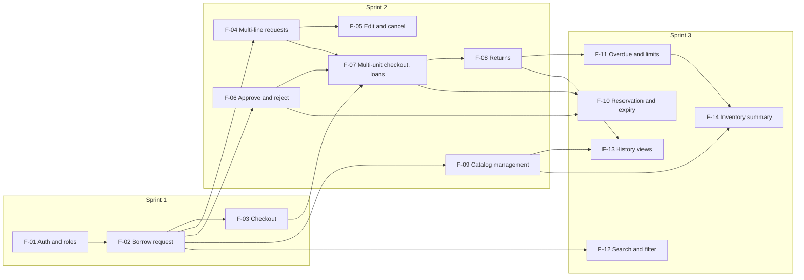

# KitHub: Three-Sprint Plan

## 1. Document info

| Field | Value |
| --- | --- |
| Product | KitHub, a web-based inventory and borrowing system |
| Course | CPE 334, Project Deliverable 1, Part D |
| Version | 1.5 |
| Date | 2026-11-07 |
| Authors | Teerakarn Noiruksa (67070501062), Methipat Mansap (67070501071) |
| Baseline | [SRS v1.3](../srs.md), [System-Level SDS v1.4](../system-sds.md) |

### Revision history

| Version | Date | Author | Change |
| --- | --- | --- | --- |
| 1.0 | 2026-11-06 | Methipat Mansap | First plan for Sprints 1 to 3 |
| 1.1 | 2026-11-06 | Methipat Mansap | Review of PR #25: baseline link updated to SDS v1.1 |
| 1.2 | 2026-11-06 | Teerakarn Noiruksa | Review of PR #26: F-03 also verifies NFR-12 (pending requests list states, AC-25) |
| 1.3 | 2026-11-06 | Methipat Mansap | Issue #34: SR-04 UI polish added to Sprint 1 (sections 2, 3.2 and 4.3), so the Deliverable 1 screenshots, the Lab 6 UAT and the demo use one finished look. Visual only: no feature, requirement or sprint moves |
| 1.4 | 2026-11-07 | Teerakarn Noiruksa, Methipat Mansap | Issue #36: baseline SRS v1.3 and SDS v1.3. Q-08 is resolved as D-20, so the F-11 dependency (3.1) cites D-20, and the 25 Nov milestone (6.3), the Sprint 3 dependencies (6.4) and the open-questions risk (8) list only Q-07 and Q-09. No feature, requirement or sprint moves |
| 1.5 | 2026-11-07 | Methipat Mansap | Issue #38 (SR-04 defect fix): baseline SDS v1.4. SR-04 (3.2) covers every width from 320 to 1440 px, with the narrow layout below 768 px instead of 576 px. No feature, requirement or sprint moves |

## 2. Overview

| Sprint | Dates | Checkpoint | Goal | Features | Release |
| --- | --- | --- | --- | --- | --- |
| 1 | 2026-11-03 to 2026-11-08 | Deliverable 1, 8 Nov | A small working borrowing slice with authentication, server-side permissions and persistence | F-01, F-02, F-03, SR-04 | `v0.1.0` |
| 2 | 2026-11-09 to 2026-11-29 | Deliverable 2, 29 Nov | The complete borrowing cycle (request, approve, check out, return) and catalog management, under contracts | F-04 to F-09 | `v0.2.0` |
| 3 | 2026-11-23 to 2026-12-13 (contracts and F-11 overlap the last week of Sprint 2) | Progress at 29 Nov; final product 13 Dec | Remaining features, integration and hardening | F-10 to F-14, SR-03 | `v1.0.0` |

Course events that use the same weeks (from the group work specification):

| Date | Event | Effect on the plan |
| --- | --- | --- |
| 8 to 15 Nov | Lab 5: Docker, CI/CD and GCP deployment of Sprint 1 (#1 to #9) | Sprint 2 week 1 is mostly Lab 5 and Sprint 2 contracts |
| 10, 12 Nov; due 22 Nov | Lab 6: cross-team UAT | UAT findings become Issues and are fixed in Sprint 2 |
| 17, 19 Nov; due 29 Nov | Lab 7: maintenance, metrics, release readiness | Shares week 2 and 3 with Sprint 2 implementation |
| 1 to 11 Dec | Final examinations | Sprint 3 work after 29 Nov is kept small; the group specification asks for a substantially complete product by 29 Nov |

Every sprint follows the course workflow: an Issue per work item, a branch from `staging`, a teammate-reviewed PR into `staging`, integration tests on `staging`, and a reviewed release PR from `staging` into `main` with a tag. Each feature's contract is merged before its implementation starts.

## 3. Features and system responsibilities

Feature IDs are stable. [`docs/features.md`](../features.md) (Part B, #11) describes each feature in full and [`docs/traceability.md`](../traceability.md) maps every requirement to its feature, sprint and tests; both use the IDs below.

### 3.1 Features

| ID | Feature | FR | BR enforced | NFR verified | Depends on | Sprint |
| --- | --- | --- | --- | --- | --- | --- |
| F-01 | Sign-in, sign-out, current user and roles | FR-01, FR-02, FR-03 | BR-05, BR-17 | NFR-01, NFR-02, NFR-03, NFR-04 | SR-01 | 1 |
| F-02 | Browse catalog and borrow request | FR-04, FR-07, FR-08 | BR-01, BR-04, BR-05, BR-16, BR-17 | NFR-02, NFR-09, NFR-12 | F-01 | 1 |
| F-03 | Checkout and active loan | FR-09, FR-16 | BR-02, BR-03, BR-16 | NFR-02, NFR-05, NFR-09, NFR-12 | F-01, F-02 | 1 |
| F-04 | Multi-line requests and item type detail | FR-05, FR-10 | BR-01, BR-04, BR-06, BR-07, BR-08, BR-17 | NFR-10 | F-02 | 2 |
| F-05 | Edit and cancel requests | FR-11, FR-12 | BR-01, BR-04, BR-07, BR-08, BR-10, BR-16, BR-17 | NFR-09 | F-04 | 2 |
| F-06 | Approve and reject requests; all-requests view | FR-13, FR-14, FR-30 | BR-09, BR-16 | NFR-02, NFR-09 | F-02 | 2 |
| F-07 | Multi-unit checkout and loan lists | FR-17, FR-18, FR-19 | BR-02, BR-03, BR-06, BR-08, BR-11, BR-12 | NFR-05 | F-03, F-04, F-06 | 2 |
| F-08 | Returns: return all and early return | FR-20, FR-21 | BR-11, BR-16 | NFR-09 | F-07 | 2 |
| F-09 | Catalog management | FR-23, FR-24, FR-25, FR-26 | BR-07, BR-08, BR-11, BR-12, BR-16 | NFR-02 | F-02 | 2 |
| F-10 | Reservation and expiry of approved requests | FR-15 | BR-01 (reserved units), BR-13, BR-16 | NFR-05, NFR-09 | F-06, F-07; Q-07, Q-09 settled | 3 |
| F-11 | Overdue status and borrowing limits | FR-22 | BR-14, BR-15 | - | F-07, F-08; D-20 | 3 |
| F-12 | Search and filter the catalog | FR-06 | - | NFR-11 | F-02 | 3 |
| F-13 | History per unit and per Borrower | FR-27, FR-28 | BR-05, BR-16 | NFR-02 | F-08, F-09 | 3 |
| F-14 | Inventory summary report | FR-29 | - | NFR-11 | F-09, F-11 | 3 |

### 3.2 System responsibilities

Some requirements are not one feature's job. They are built once and then kept true by every feature.

| ID | Responsibility | Requirements | Issues | Sprint |
| --- | --- | --- | --- | --- |
| SR-01 | Platform foundation: project skeleton, configuration, JSON error handling, health and readiness, migrations and seed (SDS sections 4.8, 6.5, 6.7, 9.1) | NFR-06, NFR-07, NFR-08 | #13 | 1 |
| SR-02 | Delivery: Docker image, CI on PRs, deployment to GCP, persistence across redeploys (SDS sections 9.5 to 9.7) | NFR-06 (redeploy), NFR-07 (Secret Manager) | #1 to #9 (Lab 5) | 2 (by 15 Nov) |
| SR-03 | Hardening: performance measurement, permission and error regression suite, UAT and maintenance defects | NFR-11; re-verifies NFR-01, NFR-02, NFR-08 | Created in Sprint 3 | 3 |
| SR-04 | UI polish: one shared visual style (theme on Bootstrap 5 CSS variables, one self-hosted font, icons, logo) for every Sprint 1 screen at every width from 320 to 1440 px, with the narrow layout (two-row navigation bar, table rows as cards) below 768 px; visual only, no behavior, API or contract text change (SDS 5.3 "Visual style") | None new; keeps NFR-12 and the SDS 5.3 accessibility rules | #34, #38 | 1 |

### 3.3 Dependencies between features

Every arrow points from a feature to one that needs it. No Sprint 1 or Sprint 2 feature depends on a later sprint.

## 4. Sprint 1

### 4.1 Goal

Release `v0.1.0` on `main`: a Borrower signs in and requests one available device; a Custodian signs in and checks out a chosen unit to that Borrower. The result is stored in PostgreSQL, protected by server-side permissions, and verified by automated tests.

### 4.2 Scope of Sprint 1 and why

Sprint 1 follows the Theme 2 example in the group work specification: "Seed a small catalog. A borrower logs in, requests one available item, and sees their request. A custodian logs in and records checkout, creating an active loan and updating availability. Reject checkout of an unavailable item and duplicate active loans for the same exclusive item." The same section asks that Borrowers see only their own requests and loans and cannot perform checkout, and that cross-Borrower access is tested. The slice needs exactly three features:

| Feature | What the slice proves |
| --- | --- |
| F-01 Sign-in, sign-out, current user and roles | Real authentication with hashed passwords and database sessions, two roles, and server-side role checks that every later feature reuses |
| F-02 Browse catalog and borrow request | A Borrower-owned record created through UI, API and database, with two business rules (BR-01 availability, BR-04 one open request per item type) and ownership (BR-05) |
| F-03 Checkout and active loan | A real state transition across three records in one transaction (request, unit, loan), with history, and the hardest rule in the product: one active loan per unit under concurrency (BR-03) |

Sprint 1 covers FR-01 to FR-04, FR-07 to FR-09 and FR-16; BR-01 to BR-05, BR-16 and BR-17; and NFR-01 to NFR-09 and NFR-12, matching the "Sprint" column of the SRS.

What Sprint 1 leaves out, and why that is safe:

| Left out | Why it can wait | How Sprint 1 prepares for it |
| --- | --- | --- |
| Approval and rejection | The Theme 2 example goes straight from pending to checkout. Checkout from `PENDING` is the Sprint 1 transition (SRS 8.2) and is replaced by FR-17 in Sprint 2 | `RequestStatus` already has every state (SDS 4.2) |
| Several lines and quantities | One unit of one item type is enough to prove the rules | The request body already uses a `lines` array, and checkout a `units` array (SDS DD-11) |
| Loan length chosen by the Borrower | Sprint 1 due date = checkout time + the item type's maximum loan length (D-16) | `dueAt` is stored on every loan from Sprint 1 |
| Returns, maintenance, retiring | Not needed to show the request-to-loan slice | `UnitStatus` and `LoanStatus` already have every state |
| Catalog management | The catalog is seeded (#13) | Category default limits from D-08 are already in the data |
| Reservations, overdue, limits, search, history views, reports | Sprint 3 features | History entries are written from Sprint 1, so Sprint 3 can show them |

Accepted Sprint 1 limitations, already decided in the SRS:

- If no unit is available at checkout, the checkout is rejected and the request stays `PENDING` until Sprint 2 adds rejection and cancellation (D-17). The seed has several units per item type.
- A pending request reserves nothing, so two Borrowers may request the last unit; only one can be checked out (A-04, D-15).

### 4.3 Work items and order

Contracts (Part E) are merged into `staging` before their implementation starts, so the history shows specification before code.

| Order | Issue | Work item | Part | Depends on |
| --- | --- | --- | --- | --- |
| 1 | #22 | SRS (merged) | A | - |
| 2 | #11 | Feature inventory and traceability | B | #22 |
| 2 | #12 | System-Level SDS and this plan | C, D | #22 |
| 3 | #13 | Project skeleton, database, migration, seed, health and readiness (SR-01) | F | #12 |
| 3 | #14 | Contract: F-01 | E | #12 |
| 4 | #15 | Contract: F-02 | E | #12, #14 |
| 4 | #17 | F-01 implementation | F | #13, #14 |
| 5 | #16 | Contract: F-03 | E | #12, #15 |
| 5 | #18 | F-02 implementation | F | #15, #17 |
| 6 | #19 | F-03 implementation | F | #16, #18 |
| 7 | #20 | End-to-end journey test | F | #17, #18, #19 |
| 7 | #34 | UI polish (SR-04): shared visual style for every Sprint 1 screen | F | #19 |
| 8 | #21 | Release `v0.1.0` and the Deliverable 1 PDF | F | #11 to #20, #34 |

### 4.4 Completion outcome

Sprint 1 is complete when all of the following are true on the tagged release:

1. **Journey**: `borrower1` signs in, sees the catalog with available counts, requests "Arduino Uno R3", sees the request as `PENDING` and signs out. `custodian1` signs in, opens Pending requests, checks out unit `KH-ARD-0001` and sees the request leave the list. `borrower1` signs in again and sees the request as `CHECKED_OUT` with its due date; the Arduino's available count is one lower. The data is still there after the server restarts.
2. **Rule rejections**: a request for the Oscilloscope (0 available) is rejected (BR-01); a second open request for the same item type is rejected (BR-04); checkout of a unit that is `ON_LOAN` or of another item type is rejected (BR-02); two simultaneous checkouts of one unit create exactly one loan (BR-03, NFR-05).
3. **Access**: calls without a session are rejected with `401`; a Borrower calling checkout and a Custodian creating a request are rejected with `403`; a Borrower reading another Borrower's request gets `404` and no data.
4. **Evidence**: every Sprint 1 AC has a passing automated test; the build and test commands, counts and tested commit are recorded; each feature has a reviewed PR into `staging`; the release PR into `main` is reviewed and tagged `v0.1.0`; a clean clone runs with the README steps only.

## 5. Sprint 2

### 5.1 Goal

Complete the borrowing cycle that the hardware room needs every day, under engineering contracts: multi-line requests with a loan length, editing and cancelling, approval and rejection, checkout of one unit per quantity, returns with condition, and catalog management by Custodians. Sprint 1 keeps working unchanged.

### 5.2 Features

F-04, F-05, F-06, F-07, F-08 and F-09 (section 3.1). They cover FR-05, FR-10 to FR-14, FR-17 to FR-21, FR-23 to FR-26 and FR-30; BR-06 to BR-12 for the first time; and NFR-10.

### 5.3 Order of work

| Week | Contracts | Implementation | Course work |
| --- | --- | --- | --- |
| 9 to 15 Nov | F-06, F-04, F-09 | - | Lab 5 deploys `v0.1.0` to GCP (SR-02); Lab 6 UAT sessions |
| 16 to 22 Nov | F-05, F-07, F-08 | F-06, F-04, F-09 | Lab 6 findings fixed; Lab 7 sessions; Lab 6 due 22 Nov |
| 23 to 29 Nov | Sprint 3 contracts (section 6.3) | F-05, F-07, F-08; release `v0.2.0` | Deliverable 2 and Lab 7 due 29 Nov |

The order follows the dependencies: F-06 (approval) and F-04 (multi-line requests) come first because F-07 needs both. F-09 has no Sprint 2 dependency and fills the same week. F-08 needs F-07.

### 5.4 Dependencies

- Sprint 1 released and deployed: `v0.1.0` on `main` and on Cloud Run (SR-02).
- SDS conventions for the new endpoints, migrations and screens (SDS sections 4.2, 5.1, 6.6). Each Sprint 2 migration is additive (SDS DD-14).
- No open SRS question blocks Sprint 2.

### 5.5 Completion outcome

1. **Journey**: a Borrower submits a request with two lines and a loan length; a Custodian approves it, checks out one unit per quantity and later records the return of all units, one of them damaged. The request is `RETURNED`, the damaged unit is `MAINTENANCE`, and the Custodian sets it back to `AVAILABLE`. A second request is rejected with a reason that the Borrower sees.
2. **Rules**: BR-06 to BR-12 each have passing tests for their rejected case. Sprint 1 rules and access tests still pass.
3. **Release**: every Sprint 2 contract was merged before its implementation; `v0.2.0` is tagged on `main`, deployed through the Lab 5 pipeline, and identifiable separately from later candidates.

## 6. Sprint 3

### 6.1 Goal

Finish the product: reservations with expiry, overdue status and borrowing limits, search, history views and the inventory report. Then harden it: a full regression run, permission and error checks on every endpoint, the performance measurement, and fixes for UAT and maintenance findings.

### 6.2 Features

F-10, F-11, F-12, F-13, F-14 and SR-03 (section 3). They cover FR-06, FR-15, FR-22, FR-27, FR-28 and FR-29; BR-13 to BR-15; and NFR-11.

### 6.3 Order of work

| Dates | Work |
| --- | --- |
| By 25 Nov | Settle the open questions that block Sprint 3 contracts: Q-07 and Q-09 (expiry, for F-10). Record each as an SRS decision. Q-08 (limit counting, for F-11) is already settled as D-20 |
| 23 to 29 Nov | Contracts for F-10 to F-14. Implement and test F-11 (overdue and borrowing limits), so that the Deliverable 2 candidate contains a meaningful, tested Sprint 3 rule (BR-14, BR-15) |
| 30 Nov to 6 Dec | F-10 and F-13. Kept small because of the examination period |
| 7 to 13 Dec | F-12, F-14 and SR-03; final release `v1.0.0`; final report and demonstration video |

F-11 goes first because it is a real business rule, depends only on Sprint 2 features, and its one decision is already made (D-20). F-10 is the largest Sprint 3 change (it alters availability for every request), so it waits until its two questions are settled and Sprint 2 is stable.

### 6.4 Dependencies

- Sprint 2 complete (`v0.2.0`).
- Q-07 and Q-09 settled before the matching contracts.
- The expiry trigger chosen in Q-09 may add a GCP component (SDS section 13, option B).

### 6.5 Completion outcome

1. **Journey**: an approved request that is not picked up within 48 hours becomes `EXPIRED` and its units become available again, recorded with the System actor. An overdue request appears on the Custodian's overdue list and blocks its Borrower's new requests until every unit is returned.
2. **Coverage**: every FR, BR and NFR in the SRS is implemented and linked to passing tests or a recorded measurement in `docs/traceability.md`, or is listed there as a disclosed gap.
3. **Release**: `v1.0.0` is tagged on `main` and deployed; the regression suite passes; known limitations are listed.

## 7. Coverage check

Every FR is allocated to exactly one feature:

| Sprint | FRs | Count |
| --- | --- | --- |
| 1 | FR-01, FR-02, FR-03, FR-04, FR-07, FR-08, FR-09, FR-16 | 8 |
| 2 | FR-05, FR-10, FR-11, FR-12, FR-13, FR-14, FR-17, FR-18, FR-19, FR-20, FR-21, FR-23, FR-24, FR-25, FR-26, FR-30 | 16 |
| 3 | FR-06, FR-15, FR-22, FR-27, FR-28, FR-29 | 6 |
| Total | | 30 |

Every BR is enforced from the sprint the SRS gives it:

| BR | First sprint | Features |
| --- | --- | --- |
| BR-01 | 1 | F-02; extended by F-04, F-05 (quantities) and F-10 (reserved units) |
| BR-02, BR-03 | 1 | F-03; extended by F-07 (several units) |
| BR-04 | 1 | F-02; kept by F-04 and F-05 |
| BR-05 | 1 | F-01 (identity from the session), F-02; kept by every feature that returns Borrower records (F-05, F-07, F-11, F-13) |
| BR-06 | 2 | F-04, F-07 |
| BR-07, BR-08 | 2 | F-04, F-05, F-07 (BR-08 due date), F-09 (limits) |
| BR-09 | 2 | F-06 |
| BR-10 | 2 | F-05 |
| BR-11 | 2 | F-08, F-09 (repair) |
| BR-12 | 2 | F-07, F-09 |
| BR-13 | 3 | F-10 |
| BR-14, BR-15 | 3 | F-11 |
| BR-16 | 1 | F-02, F-03; every feature that changes state; shown by F-13 |
| BR-17 | 1 | F-01 (role checks), F-02; kept by F-04 and F-05 |

Every NFR is established, and first verified, in a planned sprint:

| NFR | Established by | First verified | Re-verified |
| --- | --- | --- | --- |
| NFR-01 to NFR-04 | F-01 | Sprint 1 API and unit tests | Every sprint's regression run; SR-03 |
| NFR-05 | F-03 | Sprint 1 concurrent checkout test | F-07 (several units), F-10 (reservations) |
| NFR-06 | SR-01 | Sprint 1 restart test | SR-02 redeploy check in Lab 5 |
| NFR-07 | SR-01 | Sprint 1 review and clean-clone build | SR-02 (Secret Manager) |
| NFR-08 | SR-01 | Sprint 1 API tests | Every feature's error cases; SR-03 |
| NFR-09 | F-02, F-03 | Sprint 1 integration tests | Every state-changing feature |
| NFR-10 | F-04 | Sprint 2 manual check and UI test | - |
| NFR-11 | SR-03 | Sprint 3 measurement on the deployed service (Q-03) | - |
| NFR-12 | F-02, F-03 | Sprint 1 UI tests for the catalog, my requests and pending requests | Every new list |

## 8. Risks

| Risk | Effect | Response in this plan |
| --- | --- | --- |
| Labs 5 to 7 share the Sprint 2 weeks | Less time for Sprint 2 features | Week 1 is reserved for Lab 5 and contracts; features are ordered by dependency so a late feature does not block the others |
| Examinations from 1 to 11 Dec | Little time for Sprint 3 after 29 Nov | Sprint 3 contracts and F-11 are done by 29 Nov; the remaining Sprint 3 features are read-only views (F-12, F-13, F-14) except F-10 |
| Open questions Q-07, Q-09 | Sprint 3 contracts cannot be final | Deadline of 25 Nov to settle them as SRS decisions |
| A schema change breaks rollback | Lab 5 rollback restores an image that does not match the schema | Additive migrations only (SDS DD-14) |
| Regression in Sprint 1 behavior | Deliverable 2 requires the Sprint 1 journey to keep working | The Sprint 1 API and E2E tests run on every PR through CI from Lab 5 |

## 9. Changing this plan

The plan may change, but never silently. A feature that moves between sprints, or a requirement that is dropped or added, is recorded as a new revision of this document and as an approved change in `docs/traceability.md`, with the reason. A required Sprint 2 feature is not moved to Sprint 3 just to mark Sprint 2 complete.
