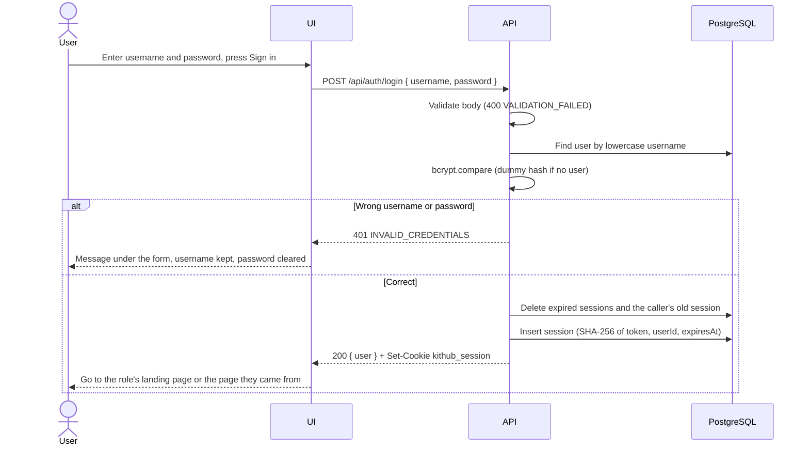

# KitHub: Engineering Contract F-01, Sign-in, sign-out, current user and roles

## 1. Document info

| Field | Value |
| --- | --- |
| Feature | F-01 Sign-in, sign-out, current user and roles |
| Sprint | 1 |
| Issue | #14 (contract), #17 (implementation) |
| Version | 1.4 |
| Status | Proposed (becomes Agreed when merged into `staging`, before #17 starts) |
| Date | 2026-11-06 |
| Authors | Teerakarn Noiruksa (67070501062) |
| Baseline | [SRS v1.2](../../srs.md), [System-Level SDS v1.1](../../system-sds.md), [Feature inventory](../../features.md) section 4.1, [Sprint plan v1.2](../plan.md) |

### Version history

| Version | Date | Author | Change | Reason |
| --- | --- | --- | --- | --- |
| 1.0 | 2026-11-06 | Teerakarn Noiruksa | First contract | Part E: contract before implementation |
| 1.1 | 2026-11-06 | Teerakarn Noiruksa | TEST-06 covers only the test-app route; the real-endpoint cases of AC-06 are TEST-41 (b) in contract F-03 (8, 8.1). Every `POST`, including logout, needs `Content-Type: application/json` (4, 4.2, 5, TEST-03). Corrected the 72-byte note (3.2), the sign-in field limits (4.1), how TEST-07 gets cost 12, and the link to the product Definition of Done (9) | Review of PR #27 |
| 1.2 | 2026-11-06 | Teerakarn Noiruksa | STS (8): every API test signs in and out through one shared helper that sends `Content-Type: application/json` on every `POST`, including logout, so setup steps do not get `415` | Note in the PR #27 re-review |
| 1.3 | 2026-11-06 | Teerakarn Noiruksa | `415` message in 4.1 is "Request body must be JSON (Content-Type: application/json)." | The `requireJson` middleware from #13 returns this message for every endpoint, so F-01 uses it instead of its own text (#17) |
| 1.4 | 2026-11-06 | Teerakarn Noiruksa | After sign-in (5): the page that sent the user to `/login` is skipped when it belongs to the other role | Review of PR #31 |

A change after this version is merged gets a new row here, and an AC or TEST change is also recorded in `docs/traceability.md` section 5.

## 2. Scope

### 2.1 Linked requirements

| Type | IDs | What F-01 does for them |
| --- | --- | --- |
| FR | FR-01, FR-02, FR-03 | Sign in with a seeded account, sign out, show the signed-in user's display name and role |
| BR | BR-05, BR-17 | Provides `req.user` from the session, which every later feature uses as owner and actor (BR-05), and `requireRole`, which later features use to keep Custodians from creating, editing or cancelling requests (BR-17). The rules themselves are tested in F-02 (AC-12, AC-14, AC-15) |
| NFR | NFR-01, NFR-02, NFR-03, NFR-04 | Rejects calls without a valid session, rejects the wrong role, stores bcrypt hashes, ends sessions at sign-out and after 8 hours |

### 2.2 In scope

- `POST /api/auth/login`, `POST /api/auth/logout`, `GET /api/auth/me`
- The `authenticate` and `requireRole` middleware used by every later endpoint (SDS 7.2)
- Session creation, lookup, expiry and deletion (SDS 8.3)
- Sign-in screen, navigation bar with the user and a sign-out button, route guards, Forbidden page
- Password hashing used by the seed (#13) and by sign-in

### 2.3 Out of scope

- Self-registration, password change and recovery (D-03, SRS 4.2)
- Limiting repeated sign-in attempts (SDS 8.6, a Sprint 3 hardening candidate)
- The seed itself: accounts and passwords come from #13 (SDS 4.8)

### 2.4 Dependencies

| Depends on | What is needed |
| --- | --- |
| #13 skeleton (SR-01) | Express app, config reader, JSON error handler, Prisma client, `users` and `sessions` tables, seeded accounts |
| SDS v1.1 | Sections 5.2, 5.3, 6, 7 and 8 |

Later features depend on F-01 for `authenticate`, `requireRole` and `req.user`.

## 3. Behavior

### 3.1 Sign-in workflow



### 3.2 Rules

| Case | Behavior | Source |
| --- | --- | --- |
| Username case | Compared in lowercase. `Borrower1` signs in as `borrower1` | SDS 4.2 |
| Unknown username or wrong password | Same `401 INVALID_CREDENTIALS` and message "Username or password is incorrect."; `bcrypt.compare` runs in both cases so the time is similar | FR-01, SDS 8.2 |
| Password longer than 72 bytes | Accepted by validation and compared normally; bcrypt compares only the first 72 bytes (SDS 8.1). The seed rejects longer passwords, so a stored password never depends on bytes after the 72nd | SDS 8.1 |
| Signing in while already signed in | The old session in the cookie is deleted and a new one is created | SDS 8.2 |
| Session lifetime | Absolute `SESSION_TTL_HOURS` (default 8) from sign-in; no renewal | NFR-04, Q-01 |
| Expired session | Rejected as `401 UNAUTHENTICATED` at once; the row is deleted at the next sign-in by any user | SDS 8.3 |
| Sign-out | Deletes the session row and clears the cookie; `204` even with no session or an expired one | FR-02, SDS 8.5 |
| Several browsers | Each sign-in has its own session; signing out in one does not end the others | SDS 8.3 |
| Role | Read from `users` on every call, never from the cookie or the client | SDS 7.2 |

### 3.3 Middleware for later features

| Middleware | Where | Behavior |
| --- | --- | --- |
| `authenticate` | All `/api` routes except `POST /api/auth/login`, `POST /api/auth/logout`, `GET /api/health`, `GET /api/ready` | Reads `kithub_session`, hashes it, loads the session with `expiresAt > now()` and its user, sets `req.user = { id, role }`. Otherwise `401 UNAUTHENTICATED` |
| `requireRole(...roles)` | On each protected route | `403 FORBIDDEN` if `req.user.role` is not listed. Runs before validation and before any record is read (SDS 6.5 order) |

`POST /api/auth/logout` runs without `authenticate`, so it reads the cookie itself.

## 4. API

All bodies are JSON. Every `POST`, including one with no body such as logout, must send `Content-Type: application/json`; otherwise the API returns `415 UNSUPPORTED_MEDIA_TYPE` (SDS 6.2). The UI's API client always sends this header on `POST`, so the rule is the same for every endpoint and keeps the cross-site protection in SDS 8.6 uniform. Every response has `Cache-Control: no-store`. Errors use the shape in SDS 6.5.

### 4.1 `POST /api/auth/login`

| Item | Value |
| --- | --- |
| Who | Anyone |
| Body | `{ "username": string, "password": string }`. Strict: both required, no other fields. `username` 1 to 64 characters, not trimmed, compared in lowercase; `password` 1 to 256 characters |
| Field limits | Contract-level choice: SDS 8.2 does not fix sign-in limits. They are wider than the stored username rule (3 to 32 characters from `a-z 0-9 . _ -`, SDS 4.2) on purpose: any value that passes validation but cannot exist gets the same `401` as a wrong password, so validation reveals nothing about stored usernames |
| Success | `200 { "user": { "id", "username", "displayName", "role" } }` and `Set-Cookie: kithub_session=<token>; HttpOnly; SameSite=Lax; Path=/; Max-Age=<SESSION_TTL_HOURS × 3600>` (`Secure` when `COOKIE_SECURE`) |

```json
{ "user": { "id": 3, "username": "borrower1", "displayName": "Borrower One", "role": "BORROWER" } }
```

| Error | Status and code | Message |
| --- | --- | --- |
| Missing, empty, too long or unknown field; malformed JSON | `400 VALIDATION_FAILED`, one `details` entry per field | "The request is not valid." |
| Unknown username or wrong password | `401 INVALID_CREDENTIALS` | "Username or password is incorrect." |
| Not JSON | `415 UNSUPPORTED_MEDIA_TYPE` | "Request body must be JSON (Content-Type: application/json)." |

The request body of this route is never logged (SDS 8.1).

### 4.2 `POST /api/auth/logout`

| Item | Value |
| --- | --- |
| Who | Anyone |
| Headers | `Content-Type: application/json`; no body |
| Success | `204`, no body, and `Set-Cookie: kithub_session=; Max-Age=0; Path=/` |
| Errors | `415 UNSUPPORTED_MEDIA_TYPE` without the header, and the session is not deleted. A missing, unknown or expired session is not an error; it is still `204` |

### 4.3 `GET /api/auth/me`

| Item | Value |
| --- | --- |
| Who | Signed in (either role) |
| Success | `200 { "user": { "id", "username", "displayName", "role" } }` |
| Error | `401 UNAUTHENTICATED`, "You are not signed in." |

`passwordHash` and session fields never appear in any response (SDS 6.3).

## 5. UI

| Element | Behavior |
| --- | --- |
| Sign-in page `/login` | Labelled Username and Password fields and a Sign in button. No pre-filled values and no user picker (SDS 8.6). Empty fields show "Enter your username." or "Enter your password." under the field without calling the API. While the call runs the button is disabled with a spinner |
| Wrong sign-in | The form stays open, keeps the username, clears the password and shows "Username or password is incorrect." (SDS 5.3) |
| After sign-in | Borrower goes to `/catalog`, Custodian to `/pending`, or to the page that sent them to `/login` (SDS 5.2), unless that page is for the other role (`/pending` for a Borrower, `/requests` for a Custodian); then the role's landing page is used, so a Borrower who signs in after a Custodian's session ended on `/pending` does not land on the Forbidden page |
| App load | Shows "Loading…" while `GET /api/auth/me` runs, so the sign-in page does not flash. `401` on a first visit opens `/login` with no message |
| Navigation bar | KitHub name, the role's links, display name with a role badge ("Borrower" or "Custodian") (FR-03), Sign out button |
| Sign out | Calls `POST /api/auth/logout` with `Content-Type: application/json`, clears the current user and opens `/login` with no message |
| Session ended | A `401 UNAUTHENTICATED` from any call after sign-in clears the user and opens `/login` with "Your session has ended. Please sign in again." (SDS 5.3) |
| Route guards | `RequireAuth` sends a signed-out user to `/login`. `RequireRole` shows the Forbidden page ("You do not have permission to do this.") for the other role's routes. These are convenience only; the API enforces access |

The pages that the role links open (Catalog, My requests, Pending requests) come from F-02 and F-03. Until they exist, the links open a placeholder page.

## 6. Data

| Layer | Change |
| --- | --- |
| `users` | Fields as in SDS 4.2: `id`, `username` (unique, lowercase), `displayName`, `role` (`BORROWER` or `CUSTODIAN`), `passwordHash` (bcrypt). Created by the first migration in #13. F-01 adds no field |
| `sessions` | `id` (SHA-256 hex of the token, PK), `userId` (FK, cascade, indexed), `expiresAt` (indexed). Created in #13. F-01 adds no field |
| Migration | None in #17 if #13's first migration has both tables as above. If #13 leaves out `sessions`, #17 adds it in an additive migration (DD-14) and records it here |
| Seed | No change; #13 seeds `custodian1`, `custodian2` and, with `SEED_DEMO_DATA=true`, `borrower1`, `borrower2` |
| Configuration | Uses `SESSION_TTL_HOURS`, `COOKIE_SECURE`, `BCRYPT_COST` (SDS 9.1). No new variable |

## 7. Acceptance criteria

Adopted from `docs/features.md` section 4.1 without change.

| AC | Expected outcome | Requirements |
| --- | --- | --- |
| AC-01 | A seeded user signs in with a valid username and password; a session starts and the current-user call returns their display name and role | FR-01, FR-03 |
| AC-02 | Sign-in with an unknown username or a wrong password is rejected with the same generic message, and no session starts | FR-01 |
| AC-03 | After sign-out, a request that reuses the old session is treated as not signed in | FR-02, NFR-04 |
| AC-04 | A new session expires 8 hours after sign-in (Proposed, Q-01), and a request that carries a session whose expiry has passed is rejected as not signed in and returns no data. The test stores a session with its expiry in the past, so no clock control is needed | NFR-04 |
| AC-05 | A protected operation called without a valid session is rejected and returns no private data | NFR-01 |
| AC-06 | A Borrower who calls a Custodian-only operation (record checkout, list the units of an item type) is rejected and nothing changes | NFR-02 |
| AC-07 | Stored passwords are salted hashes from an adaptive algorithm: no value equals its plain text, the value shows the algorithm and cost, and two accounts with the same password have different values | NFR-03 |

Related AC in other contracts: a Custodian creating a request (AC-15) and cross-Borrower access (AC-14) are in F-02, #15.

## 8. Software Test Specification

Levels and tools follow SDS section 10. API tests run against `kithub_test` with seeded `custodian1` and `borrower1` (test passwords set in the test environment) and `BCRYPT_COST=4` for speed. TEST-07 passes cost 12 explicitly and checks the default separately.

All API tests sign in and sign out through one shared helper in `server/tests/helpers/`, which sends `Content-Type: application/json` on every `POST`, including logout (section 4.2). A setup step that signs out without the header would get `415` and leave the session in place, so the tests would not start from the state they assume. Later contracts use the same helper, for example the signed-out-session setup of TEST-41 (a) in F-03.

| Test | AC | Level | Precondition / input | Action | Expected result |
| --- | --- | --- | --- | --- | --- |
| TEST-01 | AC-01 | API | `borrower1` and `custodian1` exist. Valid username and password for each; a second case sends `Borrower1` in upper case | `POST /api/auth/login`, then `GET /api/auth/me` with the returned cookie | Login `200` with `user.username`, `displayName`, `role`; `Set-Cookie` has `kithub_session`, `HttpOnly`, `SameSite=Lax`; one new row in `sessions`; `/me` `200` with the same user and role. No `passwordHash` in either body |
| TEST-02 | AC-02 | API | Cases: unknown username `nobody`; `borrower1` with a wrong password; empty password; unknown field `role` | `POST /api/auth/login` | Unknown username and wrong password: both `401 INVALID_CREDENTIALS` with the identical `message`, no `Set-Cookie`, `sessions` row count unchanged. Empty password and unknown field: `400 VALIDATION_FAILED` with the field in `details`, no session |
| TEST-03 | AC-03 | API | `borrower1` signed in; cookie value saved. Every logout below sends `Content-Type: application/json` unless stated | (a) `POST /api/auth/logout` without `Content-Type`. (b) `POST /api/auth/logout`, then `GET /api/auth/me` with the saved cookie. (c) `POST /api/auth/logout` again with no cookie | (a) `415 UNSUPPORTED_MEDIA_TYPE` and the session row still exists. (b) Logout `204` with `Max-Age=0`; the session row is gone; `/me` `401 UNAUTHENTICATED`. (c) `204` |
| TEST-04 | AC-04 | API | (a) `borrower1` signs in. (b) A session row for `borrower1` inserted with `expiresAt = now() - 1 minute` and a known token | (a) read the new session row. (b) `GET /api/auth/me` with that token | (a) `expiresAt` is sign-in time + 8 hours (±1 minute) and cookie `Max-Age` is 28800. (b) `401 UNAUTHENTICATED`, body has only `error`, no user fields |
| TEST-05 | AC-05 | API | No cookie; a cookie with a random unknown token | `GET /api/auth/me`, and `GET /api/categories` once F-02 exists | `401 UNAUTHENTICATED` with the SDS 6.5 error shape and no private data. `/api/health` and `POST /api/auth/login` stay reachable without a cookie |
| TEST-06 | AC-06 | API | `borrower1` and `custodian1` signed in. A route registered only in the test app as `POST /api/test/custodian-only` with `requireRole("CUSTODIAN")`, whose handler writes a row | Call the route with the Borrower's cookie, then with the Custodian's cookie | Borrower: `403 FORBIDDEN` with only the `error` object; the handler never runs, so no row is written. Custodian: passes the role check and the handler writes its row |
| TEST-07 | AC-07 | Unit | (a) `hashPassword(password, 12)` called twice with the same plain password; the cost is passed explicitly, so the test does not depend on `BCRYPT_COST=4` in the test environment. (b) The config reader with `BCRYPT_COST` unset | (a) Hash, then inspect the values. (b) Read the cost | (a) Neither value equals the plain text; both start with `$2a$12$` or `$2b$12$`; the two values differ; `verifyPassword` accepts the right password and rejects a wrong one. (b) The default cost is 12 |

UI behavior in section 5 is checked by the E2E tests in #20: sign-in and sign-out in TEST-30, the forbidden case in TEST-32. Selected component tests (wrong sign-in keeps the username, first visit shows no message) are added in #17 if time allows and are not required for this contract.

### 8.1 Where the AC-06 cases are tested

The Custodian-only endpoints named in AC-06 are built in F-03 (#19), after F-01 (#17). So TEST-06 tests `requireRole` on a route that exists only in the test app, which proves the middleware rejects the wrong role before the handler runs. The real-endpoint cases of AC-06, a Borrower calling `GET /api/item-types/:id/units` and `POST /api/requests/:id/checkout`, are TEST-41 (b) in contract F-03 (`docs/sprints/sprint-1/F-03-checkout.md`, #16), which #19 implements. AC-06 is therefore verified by TEST-06, TEST-41 (b) and the E2E test TEST-32.

## 9. Definition of Done

The product-level Definition of Done for Sprint 1 is [Product Definition of Done](definition-of-done.md), added by contract F-03 (#28); it applies to F-01 as well. Whichever of #27 and #28 merges second turns that path into a link. The items below are what F-01 must show for it.

F-01 is done when all of the following are true and recorded in the PR for #17:

1. The behavior in sections 3 to 6 is implemented; any difference is recorded in the version history with its reason.
2. The failing tests for AC-01 to AC-07 were committed before the implementation (TDD evidence), and the commit is named in the PR.
3. TEST-01 to TEST-07 pass; the command, the counts (passed, failed, skipped) and the tested commit are in the PR. Failed or skipped tests are disclosed, not removed.
4. No password, token or secret is in the repository, the logs or any API response.
5. The PR into `staging` is reviewed by the teammate with a specific check or finding, and CI passes.
6. `README` setup steps still work from a clean clone, and the traceability rows for F-01 are updated.
7. Known incomplete work is listed in the PR.
