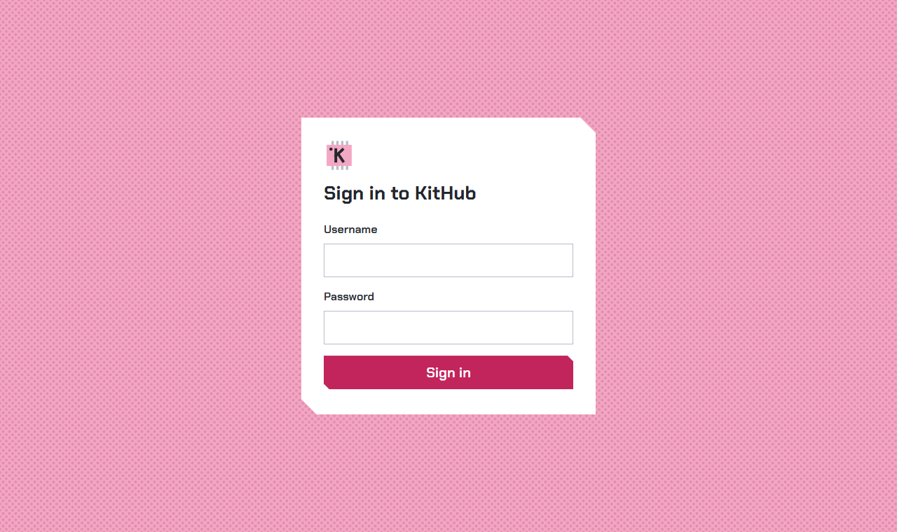
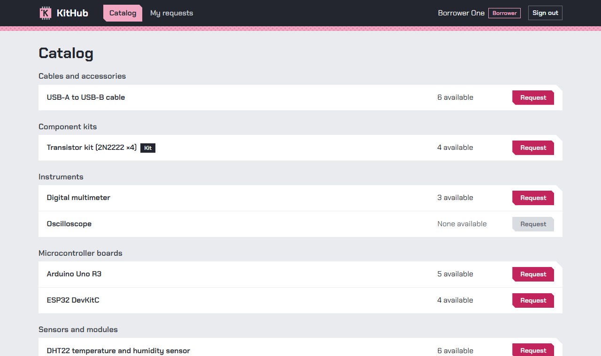
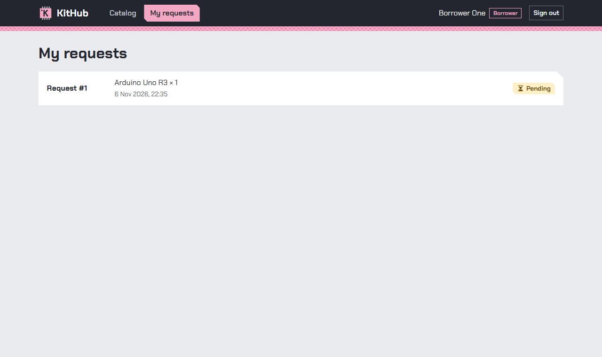
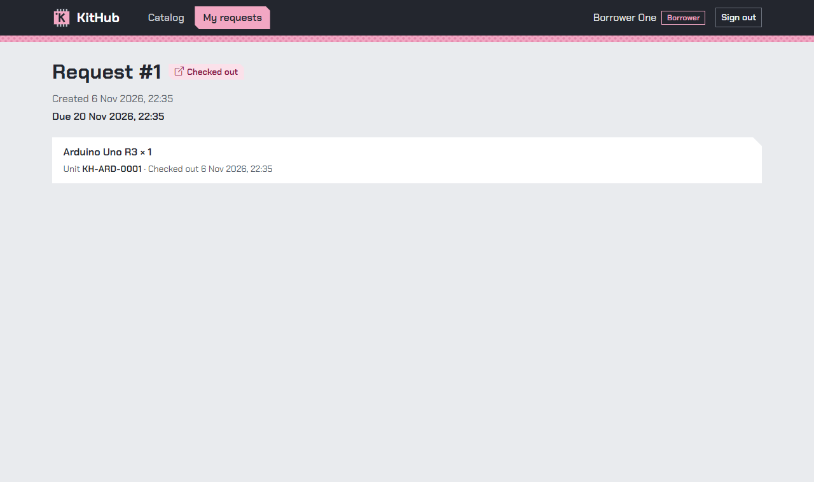
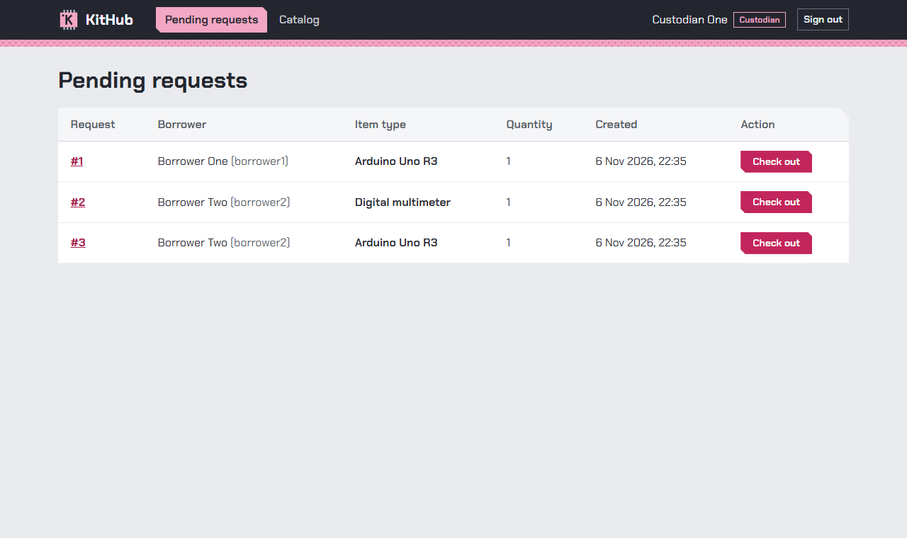
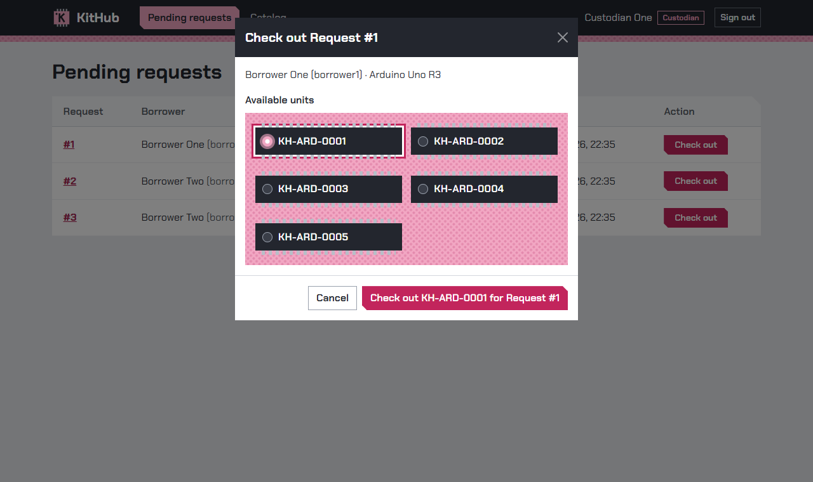
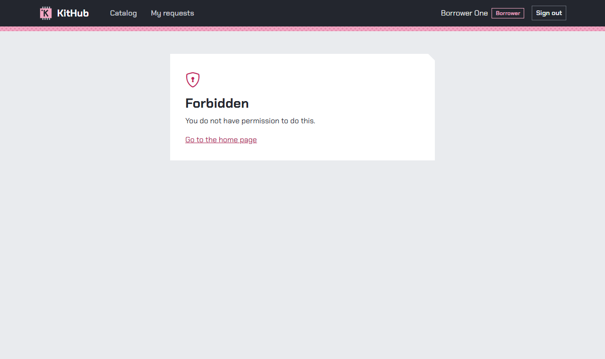
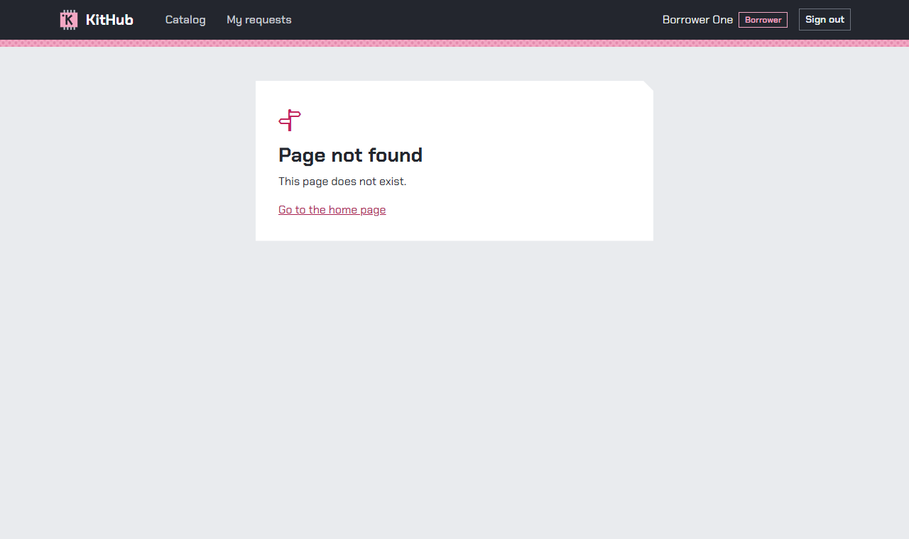

# Sprint 1 Manual Test Guide

| Field | Value |
| --- | --- |
| Covers | Sprint 1: F-01 sign-in and roles, F-02 catalog and borrow request, F-03 checkout and active loan |
| Screenshots taken on | commit `95ce498` (branch `ui/34-polish`, #34, SR-04 visual style), local dev servers, fresh demo database. MT-01 to MT-17 all gave the expected result |
| Time needed | About 20 minutes |
| Used for | Teammate and Lab 6 UAT walkthroughs; screenshots for Deliverable 1 Part F |

**MT scenarios are manual checks.** They supplement the automated tests (TEST-xx) and do not replace them. Every rule shown here is also checked by an automated API or UI test against the real test database. Section 7 maps each MT scenario to its tests.

## 1. Start from zero

You need the [README prerequisites](../../../README.md#prerequisites) (Node.js 24, PostgreSQL 16 in Docker or installed locally) and Git.

1. Clone the repository and open a terminal in its root folder.
2. Create the `kithub` and `kithub_test` databases. Follow [README section 1](../../../README.md#1-start-postgresql-and-create-the-databases): Option A uses Docker, Option B a local install.
3. Copy the environment files ([README section 2](../../../README.md#2-configure-the-environment)):

   ```sh
   cp server/.env.example server/.env
   cp client/.env.example client/.env
   ```

   In `server/.env`, fill in:

   | Variable | What to put |
   | --- | --- |
   | `DATABASE_URL`, `TEST_DATABASE_URL` | Replace `<local-db-password>` with the database password you chose in step 2 |
   | `SEED_CUSTODIAN_PASSWORD`, `SEED_BORROWER_PASSWORD` | Passwords you choose for the demo accounts |
   | `SEED_DEMO_DATA` | `true`, so the Borrower accounts are created |

   Choose your own passwords. Never commit `.env` or paste its values anywhere. `client/.env` can stay as it is.
4. Install, migrate, seed and start the server ([README section 3](../../../README.md#3-server-install-migrate-seed-run)):

   ```sh
   cd server
   npm ci
   npx prisma migrate deploy
   npm run prisma:seed
   npm run dev
   ```

   The API listens on port 3000. Leave this terminal open.
5. In a second terminal, start the client ([README section 4](../../../README.md#4-client-install-and-run)):

   ```sh
   cd client
   npm ci
   npm run dev
   ```

6. Open **http://localhost:5173**.

### Reset to a fresh demo

The scenarios in section 4 expect a fresh database (no requests, every unit available), and request numbers start at #1. To start again:

```sh
cd server
npx prisma migrate reset
```

Answer `y`. This **deletes all data in the `kithub` database** named in `DATABASE_URL`, applies the migrations again and runs the seed. It never touches `kithub_test`. Then restart `npm run dev` in `server/`.

## 2. Accounts

| Username | Display name | Role | Password |
| --- | --- | --- | --- |
| `borrower1` | Borrower One | Borrower | The value you set in `SEED_BORROWER_PASSWORD` |
| `borrower2` | Borrower Two | Borrower | The value you set in `SEED_BORROWER_PASSWORD` |
| `custodian1` | Custodian One | Custodian | The value you set in `SEED_CUSTODIAN_PASSWORD` |
| `custodian2` | Custodian Two | Custodian | The value you set in `SEED_CUSTODIAN_PASSWORD` |

The seed also creates 6 categories, 9 item types and 38 units. Each Arduino Uno R3 unit has an asset tag from `KH-ARD-0001` to `KH-ARD-0005`. The Digital multimeter (3 units, 3-day loans) is in the Instruments category. The Oscilloscope has one unit, which is in maintenance, so 0 are available.

## 3. What the app looks like

Every signed-in page has a navigation bar with the links for your role, your display name, a role badge and **Sign out**.

| Role | Lands on | Links |
| --- | --- | --- |
| Borrower | Catalog | Catalog, My requests |
| Custodian | Pending requests | Pending requests, Catalog |

**Sign in.** Username and password. A wrong pair shows one generic message and clears the password.



**Catalog (Borrower).** Categories with their item types and the number of available units. A Borrower has a **Request** button per item type. It is disabled with "None available" when the count is 0.



**My requests (Borrower).** The Borrower's own requests, newest first, with state, item and creation time (Asia/Bangkok). The empty state links to the catalog.



**Request detail.** Title with the state badge, creation time and the line. After checkout it also shows the due date, the unit's asset tag and the checkout time.



**Pending requests (Custodian).** Every Borrower's `PENDING` request, oldest first: request, borrower, item type, quantity, creation time and **Check out**.



**Checkout dialog (Custodian).** Lists the `AVAILABLE` units of the requested item type. The confirm button names the unit and the request. After a successful checkout the page shows the asset tag and the due date.



**Forbidden.** Shown when a user opens a page of the other role, for example a Borrower at `/pending`.



**Not found.** Shown for an address that does not exist.



## 4. Test scenarios

Run the scenarios in order on a fresh database (section 1). Write what you see in **Actual result**: "As expected", or what differed. Request numbers assume a fresh database.

| ID | Feature / AC | Role | Starting conditions | Steps | Expected result | Actual result |
| --- | --- | --- | --- | --- | --- | --- |
| MT-01 | F-01 / AC-02 | None | Signed out, at `/login` | Enter `borrower1` and a wrong password; press **Sign in** | "Username or password is incorrect."; the username stays and the password field is empty; still on the sign-in page ([screenshot](img/02-sign-in-wrong-password.png)) | |
| MT-02 | F-01 / AC-01, AC-03 | Borrower | Signed out | Sign in as `borrower1`; look at the navigation bar; press **Sign out** | Lands on Catalog; the bar shows "Borrower One" and a "Borrower" badge; Sign out opens the sign-in page | |
| MT-03 | F-01 / AC-05 | None | Signed out | Type `http://localhost:5173/catalog` in the address bar | The sign-in page opens instead of the catalog. After signing in you return to `/catalog` | |
| MT-04 | F-02 / AC-08 | Borrower | Fresh database; signed in as `borrower1` | Look at the Catalog | Each category lists its item types with a count: Arduino Uno R3 "5 available", Digital multimeter "3 available" ([screenshot](img/03-catalog-borrower.png)) | |
| MT-05 | F-02 / AC-17 (empty) | Borrower | `borrower1` has no requests | Open **My requests** | "You have no requests yet." with a "Browse the catalog" link ([screenshot](img/04-my-requests-empty.png)) | |
| MT-06 | F-02 / AC-09, AC-13 | Borrower | As MT-05 | In Catalog, press **Request** on Arduino Uno R3; follow "See My requests"; open the request | "Request #1 submitted."; My requests shows Request #1, **Pending**, "Arduino Uno R3 × 1" and the creation time; the detail page shows the same ([list](img/05-my-requests.png), [detail](img/06-request-detail-pending.png)) | |
| MT-07 | F-02 / AC-11 | Borrower | `borrower1` has pending Request #1 for Arduino Uno R3 | In Catalog, press **Request** on Arduino Uno R3 again | Alert "You already have an open request for Arduino Uno R3 (Request #1)."; no new request in My requests ([screenshot](img/07-catalog-duplicate-refused.png)) | |
| MT-08 | F-02 / AC-10 | Borrower | Signed in as `borrower1` | Scroll to Instruments → Oscilloscope | "None available" and a disabled **Request** button, so no request can be sent ([screenshot](img/08-catalog-oscilloscope-none.png)). The server-side refusal ("Oscilloscope has no available units.") is checked by TEST-10 | |
| MT-09 | F-01 / AC-06 (UI); F-03 route guard | Borrower | Signed in as `borrower1` | Type `http://localhost:5173/pending`; then `http://localhost:5173/no-such-page` | `/pending`: "Forbidden. You do not have permission to do this."; the second address: "Page not found". The API refuses a Borrower's checkout with `403` (TEST-41 (b)) | |
| MT-10 | F-02 / AC-09 | Borrower | Sign out; sign in as `borrower2` | Request **Digital multimeter**, then **Arduino Uno R3** | "Request #2 submitted." then "Request #3 submitted." | |
| MT-11 | F-03 / AC-18; F-02 / AC-15 (UI) | Custodian | Requests #1, #2, #3 pending | Sign out; sign in as `custodian1`; look at the list; open **Catalog** | Lands on **Pending requests** with rows #1, #2, #3 (oldest first), each with borrower, item type, quantity 1, time and **Check out** ([screenshot](img/11-pending-requests.png)). The Custodian catalog shows counts but **no Request buttons** ([screenshot](img/12-catalog-custodian.png)) | |
| MT-12 | F-03 / AC-19, AC-48, AC-49 | Custodian | As MT-11 | Back to Pending requests; **Check out** on #1; look at the unit list; choose `KH-ARD-0001`; press the confirm button | The dialog says "Borrower One (borrower1) · Arduino Uno R3" and lists only Arduino units `KH-ARD-0001` to `KH-ARD-0005`. The confirm button reads "Check out KH-ARD-0001 for Request #1" ([screenshot](img/13-checkout-dialog.png)). After confirming, the dialog closes, "Request #1 checked out: KH-ARD-0001, due *[14 days later, same time]*" is shown, and #1 leaves the list ([screenshot](img/14-checkout-success.png)) | |
| MT-13 | F-03 / AC-26 | Custodian, then Borrower | After MT-12 | Open **Catalog** (still as `custodian1`) and read the Arduino count. Later, after MT-15, sign in as `borrower1` and open My requests → Request #1 | Arduino Uno R3 shows "4 available" (was 5). As `borrower1`: Request #1 is **Checked out** in the list; the detail shows "Due *[14 days after checkout]*" and "Unit KH-ARD-0001 · Checked out *[time]*" ([screenshot](img/17-request-detail-checked-out.png)) | |
| MT-14 | F-03 / AC-19; SRS D-08, D-16 | Custodian | Request #2 (Digital multimeter) pending | **Check out** on #2; choose `KH-DMM-0001`; confirm; open the request (`/requests/2`) | "Request #2 checked out: KH-DMM-0001, due *[3 days later, same time]*"; the detail shows a due date 3 days after the checkout time | |
| MT-15 | F-03 / AC-47, AC-49 (rule rejection) | Two Custodians | Request #3 pending. Open a second browser (or a private window) and sign in there as `custodian2` | In both windows press **Check out** on #3. In window 1 choose `KH-ARD-0002` and confirm. In window 2 choose another unit and confirm | Window 1: "Request #3 checked out: KH-ARD-0002, …". Window 2: the dialog stays open with the alert "Request #3 cannot be checked out because it is CHECKED_OUT, not PENDING.", and the list behind it reloads ([screenshot](img/15-checkout-conflict.png)). Only one loan exists for #3 | |
| MT-16 | F-03 / AC-25; F-02 / AC-17 | Custodian | No pending requests left; signed in as `custodian1` | (a) Open Pending requests. (b) In browser DevTools → Network, set throttling to "Slow 3G", then reload. (c) Set throttling back to "No throttling". Stop the server (Ctrl+C in its terminal) and click **Catalog**. (d) Start the server again (`npm run dev`) and press **Try again** | (a) "No pending requests." ([screenshot](img/16-pending-empty.png)). (b) "Loading…" with a spinner before the list ([screenshot](img/18-pending-loading.png)). (c) An error message ("Something went wrong." through the dev proxy) with a **Try again** button ([screenshot](img/19-error-try-again.png)). (d) The catalog loads | |
| MT-17 | NFR-06 | Custodian or Borrower | After MT-16 (the server was restarted) | Open `/requests/1` and `/requests/3` | Both are still **Checked out** with their units (`KH-ARD-0001`, `KH-ARD-0002`) and due dates; you are still signed in (sessions are stored in the database) | |

## 5. Known Sprint 1 limitations

These are expected in Sprint 1 and are not defects:

- **No approve or reject.** A Custodian checks out a `PENDING` request directly. Approval arrives in Sprint 2 (F-06).
- **No cancel.** A Borrower cannot withdraw a request (Sprint 2, F-05).
- **No return.** A checked-out unit stays `ON_LOAN`, and its request stays **Checked out** (Sprint 2, F-08).
- **No available unit means the request stays pending (D-17).** If every unit of the item type is out, the checkout dialog says "No unit of … is available. The request stays pending." and the request cannot be closed until Sprint 2. The seed has several units per item type, so this walkthrough does not reach that state. TEST-20 and TEST-49 (c) check it automatically.
- **One unit per request.** A request has one line with quantity 1. Several units per request arrive in Sprint 2 (F-07).
- **Due date = checkout time + the item type's maximum loan length** (14 days for boards and sensors, 3 for instruments, D-16). Choosing a loan length arrives in Sprint 2.
- **No overdue status, loan lists or history screens** (Sprints 2 and 3). History entries are written, but there is no page to view them.
- **API down when a page is first opened.** If the server is stopped and you reload the page, the app shows the sign-in page instead of an error, because the "who am I" call fails first (F-01 behaviour). To see the error state, stop the server while already signed in (MT-16 (c)).

## 6. Troubleshooting

| Problem | Fix |
| --- | --- |
| `npm run dev` in `server/` stops with a configuration or seed message naming a variable | Fill in that variable in `server/.env` (section 1, step 3). The message names the variable but never prints its value |
| `Can't reach database server at localhost:5432` | PostgreSQL is not running. Docker: `docker start kithub-pg`. Local install: start the PostgreSQL service |
| Sign-in always says "Username or password is incorrect." | You are using a different password from the one in `SEED_*_PASSWORD`. The seed never changes an existing account, so after changing the variable, reset the demo database (section 1) |
| Every page shows "Something went wrong." | The server on port 3000 is not running, or it crashed. Check its terminal and restart `npm run dev` in `server/` |
| Request numbers or counts differ from section 4 | The database is not fresh. Reset it (section 1) |

## 7. Automated tests behind each scenario

| MT | Automated tests |
| --- | --- |
| MT-01 to MT-03 | TEST-01, TEST-02, TEST-03, TEST-05 (`server/tests/api/auth.test.ts`); F-01 UI tests (`client/tests/App.test.tsx`) |
| MT-04 to MT-08, MT-10 | TEST-08 to TEST-11, TEST-13, TEST-17, TEST-40 |
| MT-09 | TEST-06, TEST-41 (b) (API); "a Borrower opening a Custodian route sees the Forbidden page" (`client/tests/App.test.tsx`) |
| MT-11 | TEST-18, TEST-15 |
| MT-12, MT-14 | TEST-19, TEST-48, TEST-49, TEST-50 |
| MT-13 | TEST-26 |
| MT-15 | TEST-47, TEST-22 |
| MT-16 | TEST-25, TEST-17 |
| MT-17 | TEST-27 (`server/tests/api/persistence.test.ts`, NFR-06) |
