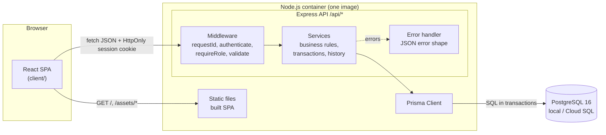
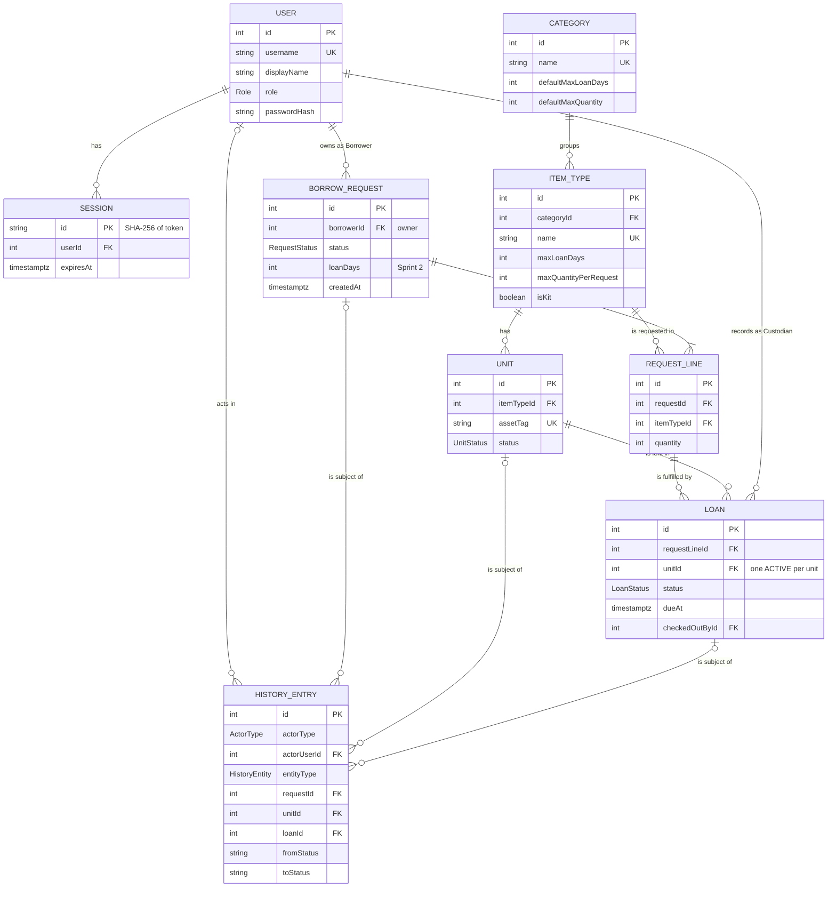
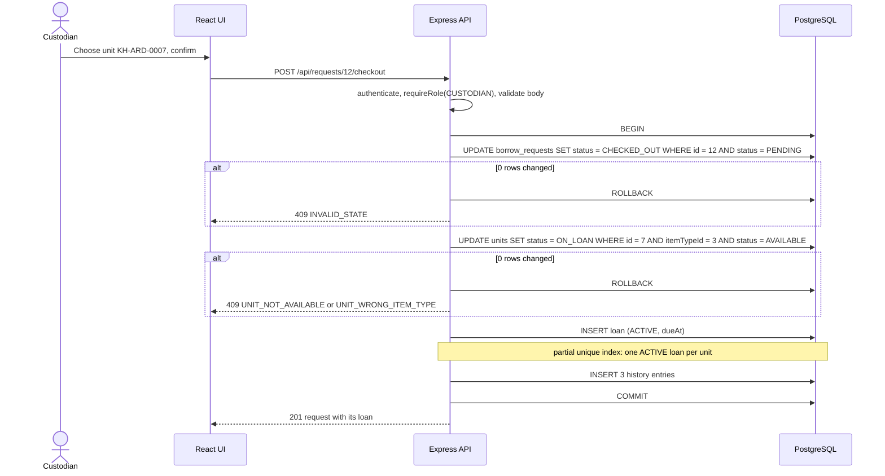
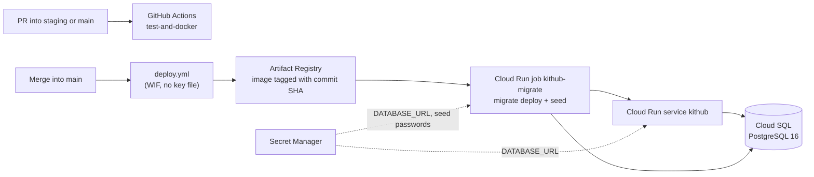

# KitHub: System-Level Software Design Specification

## 1. Document info

| Field | Value |
| --- | --- |
| Product | KitHub, a web-based inventory and borrowing system |
| Course | CPE 334, Project Deliverable 1, Part C |
| Version | 1.0 |
| Date | 2026-11-06 |
| Authors | Teerakarn Noiruksa (67070501062), Methipat Mansap (67070501071) |
| Baseline | [SRS v1.2](srs.md) |
| Related | [Three-sprint plan](sprints/plan.md), feature contracts in `docs/sprints/sprint-N/` |

### Revision history

| Version | Date | Author | Change |
| --- | --- | --- | --- |
| 1.0 | 2026-11-06 | Methipat Mansap | First baseline for the whole product (Sprints 1 to 3) |

## 2. Introduction

### 2.1 Purpose

This document describes how KitHub is built: the stack, the components and their responsibilities, the data model, the UI and API conventions, access control, authentication, configuration and the planned deployment. It covers all three sprints, so that Sprint 1 is built on a design that later sprints can extend without rework.

The SRS defines *what* the product does. This document defines the *conventions and structures* every feature must follow. Each feature contract (Part E) gives the exact screens, endpoints, request and response bodies, and migrations for that feature, and must stay consistent with this document. If a contract needs to break a convention, the change is made here first, with a new revision row.

### 2.2 Design decisions referenced in this document

Design decisions have IDs `DD-xx` and are listed in section 12. SRS IDs (FR, BR, NFR, D, A, Q) refer to [srs.md](srs.md).

## 3. Architecture

### 3.1 Stack and why

| Layer | Choice | Why |
| --- | --- | --- |
| UI | React 18 + TypeScript, built with Vite; React Router for navigation; Bootstrap 5 for layout and form styles | The team used this stack in Labs 1 to 4, and the group specification encourages keeping the lab stack. A single-page app talks to the API only through JSON |
| API / application | Node.js 24 + Express 4 + TypeScript; zod for request validation; bcryptjs for password hashing | Same stack as Labs 1 to 4 and the Lab 5 starter kit (Node.js 24 image). zod gives strict schemas that reject unknown fields (DD-09). bcryptjs is pure JavaScript, so the Alpine image needs no native build |
| Data access | Prisma ORM (schema, migrations, client) | Versioned migrations in Git, typed queries, interactive transactions for multi-row changes. The Lab 5 kit runs `prisma migrate deploy` in a Cloud Run job |
| Database | PostgreSQL 16 | Relational data with foreign keys, unique and partial unique indexes, CHECK constraints and triggers, which the business rules need (section 4.3). Same engine locally, in CI and on Cloud SQL |
| Tests | Vitest (unit and API), Supertest (HTTP), Testing Library (components), Playwright (end-to-end) | Same tools as Labs 1 to 4; API tests run against a real PostgreSQL test database |
| Packaging | One Docker image that serves the API and the built UI (DD-01) | Matches the Lab 5 starter kit: one Cloud Run service, same origin for UI and API |

Exact package versions are pinned in each `package-lock.json` by the project skeleton (#13).

### 3.2 Components and responsibilities

| Component | Responsibilities | Must not |
| --- | --- | --- |
| UI (`client/`) | Screens and navigation by role. Calls the API. Shows loading, empty, error and validation states. Formats times in Asia/Bangkok (A-06). Repeats simple input checks for fast feedback | Hold the only copy of any data. Decide permissions. Send a user ID, role or owner to the API |
| API (`server/`) | Authenticates every protected call from the session cookie. Checks role and record ownership. Validates input. Enforces business rules and state transitions in transactions. Writes history entries. Maps every error to the JSON error shape | Trust any identity, role or owner sent by the client. Return stack traces or internal details. Keep state in memory between requests |
| Database (PostgreSQL) | Stores every record, including sessions and history. Enforces keys, uniqueness, CHECK constraints, one active loan per unit, and append-only history | Be reached by anything other than the API (and the migration job) |

### 3.3 Architecture diagram



### 3.4 How the components communicate

| From → to | Protocol and format | Notes |
| --- | --- | --- |
| Browser → container | HTTP locally, HTTPS on Cloud Run. JSON request and response bodies. The session cookie is sent automatically | UI and API share one origin (DD-01). In development, the Vite dev server proxies `/api` to Express on port 3000, so the browser still sees one origin and no CORS setup is needed |
| API → database | Prisma Client over TCP locally and in CI; over the Cloud SQL Unix socket on Cloud Run | One Prisma Client per process. Multi-row changes run in one interactive transaction (`prisma.$transaction`) |
| Migration job → database | `prisma migrate deploy`, then the seed script | Runs before the server starts (Docker Compose) or before each release (Cloud Run job) |

The browser never connects to the database, and the API keeps no state between requests other than in the database (NFR-06).

### 3.5 Where business rules are enforced

Every rule is enforced on the server. The UI may repeat a check to give faster feedback, but a UI check is never the only check.

| Layer | What it enforces | Examples |
| --- | --- | --- |
| UI | Input hints only: required fields, number ranges, disabled actions | "Request" button disabled when 0 units are available. The API still rejects the request (BR-01) |
| Route + middleware | Authentication (NFR-01), role (NFR-02, BR-17), request shape and unknown fields (DD-09) | `requireRole("CUSTODIAN")` on checkout; a body with `borrowerId` is rejected (BR-05) |
| Service | Business rules, ownership scope, state transitions, history, transactions | BR-01, BR-02, BR-04, BR-05, the state models in SRS section 8, BR-16 history entries |
| Domain module (`server/src/domain/`) | Pure functions used by services: allowed transitions per entity, due-date calculation, availability formulas | `assertTransition("UNIT", "AVAILABLE", "ON_LOAN")`; unit-tested without a database |
| Database | Last line of defense for rules that must hold even if a service has a bug or two calls race | Unique asset tag, one `ACTIVE` loan per unit (BR-03), append-only history (BR-16), CHECK constraints |

The state models in SRS section 8 are encoded once, as data, in `server/src/domain/transitions.ts`. Every service calls `assertTransition` before it changes a state, so an invalid transition is rejected in the same way everywhere, and the table can be unit-tested against SRS section 8.

### 3.6 Code layout

```text
client/
  src/
    api/          fetch wrapper (JSON, credentials, error parsing) and one module per feature
    auth/         AuthProvider (current user), RequireAuth, RequireRole route guards
    components/   NavBar, AsyncState (loading/empty/error), FormField, StatusBadge, ConfirmDialog
    pages/        one folder per screen (section 5.1)
  tests/          component tests
server/
  prisma/         schema.prisma, migrations/, seed.ts
  src/
    index.ts      reads config, starts HTTP server on 0.0.0.0:PORT
    app.ts        Express app: middleware, routers, static SPA, error handler
    core/         config, errors, prisma client, middleware
    domain/       pure rules: transitions, due date, availability
    features/     auth, catalog, requests, loans, units, history, reports
                  (each: *.routes.ts, *.service.ts, *.schemas.ts)
  tests/          unit/, api/, helpers/
e2e/              Playwright journeys
docs/             SRS, SDS, features, traceability, sprint plan and contracts
```

## 4. Data model

### 4.1 Entity overview



The diagram shows keys and the most important fields. Section 4.2 lists every field.

### 4.2 Entities and fields

Conventions for every table:

- Primary keys are auto-increment integers, except `sessions` (DD-12).
- Every timestamp is `timestamptz` (Prisma `DateTime @db.Timestamptz(3)`) and stores an instant in UTC. The UI shows it in Asia/Bangkok time (A-06).
- `createdAt` and `updatedAt` exist on every table except `sessions` (`createdAt` only) and `history_entries` (`occurredAt` only), and are not repeated below.
- Records are never deleted through the product. Foreign keys use `ON DELETE RESTRICT`, except `sessions.userId`, which cascades.
- State enums are created with every SRS state in the first migration. The API performs only the transitions of the released sprint (SRS section 8).
- Columns marked Sprint 2 or 3 are added by additive migrations in that sprint.

Enums:

| Enum | Values | Source |
| --- | --- | --- |
| `Role` | `BORROWER`, `CUSTODIAN` | D-02 |
| `UnitStatus` | `AVAILABLE`, `ON_LOAN`, `MAINTENANCE`, `RETIRED` | SRS 8.1 |
| `RequestStatus` | `PENDING`, `APPROVED`, `REJECTED`, `CANCELLED`, `CHECKED_OUT`, `RETURNED`, `EXPIRED` | SRS 8.2 |
| `LoanStatus` | `ACTIVE`, `RETURNED` | SRS 8.3 |
| `ReturnCondition` | `GOOD`, `DAMAGED` | BR-11 |
| `ActorType` | `USER`, `SYSTEM` | BR-16, glossary "System actor" |
| `HistoryEntity` | `REQUEST`, `UNIT`, `LOAN` | BR-16 |

#### User (`users`)

| Field | Type | Constraints | Notes | Sprint |
| --- | --- | --- | --- | --- |
| id | int | PK | | 1 |
| username | text | unique, not null | Stored in lowercase; 3 to 32 characters from `a-z 0-9 . _ -`. Sign-in compares in lowercase | 1 |
| displayName | text | not null | Shown in the navigation bar (FR-03) | 1 |
| role | `Role` | not null | Exactly one role per account (D-02) | 1 |
| passwordHash | text | not null | bcrypt hash (section 8.1). Never selected into an API response | 1 |

#### Session (`sessions`)

| Field | Type | Constraints | Notes | Sprint |
| --- | --- | --- | --- | --- |
| id | text | PK | SHA-256 hex digest of the session token. The token itself is never stored (section 8.3) | 1 |
| userId | int | FK → users, not null, cascade on delete, indexed | | 1 |
| expiresAt | timestamptz | not null, indexed | Sign-in time + `SESSION_TTL_HOURS` (NFR-04) | 1 |

#### Category (`categories`)

| Field | Type | Constraints | Notes | Sprint |
| --- | --- | --- | --- | --- |
| id | int | PK | | 1 |
| name | text | unique, not null | For example "Microcontroller boards" | 1 |
| description | text | nullable | | 1 |
| defaultMaxLoanDays | int | not null, CHECK ≥ 1 | D-08 default, copied to new item types in this category | 1 |
| defaultMaxQuantity | int | not null, CHECK ≥ 1 | D-08 default, copied to new item types in this category | 1 |

#### Item type (`item_types`)

| Field | Type | Constraints | Notes | Sprint |
| --- | --- | --- | --- | --- |
| id | int | PK | | 1 |
| categoryId | int | FK → categories, not null, indexed | | 1 |
| name | text | unique, not null | For example "Arduino Uno R3" | 1 |
| description | text | not null, may be empty | FR-05 | 1 |
| maxLoanDays | int | not null, CHECK ≥ 1 | Sprint 1 due date (D-16); upper limit of a request's loan length (BR-08) | 1 |
| maxQuantityPerRequest | int | not null, CHECK ≥ 1 | BR-07 | 1 |
| isKit | boolean | not null, default false | Shown as a label. A kit is one unit (D-12) | 1 |

#### Unit (`units`)

| Field | Type | Constraints | Notes | Sprint |
| --- | --- | --- | --- | --- |
| id | int | PK | | 1 |
| itemTypeId | int | FK → item_types, not null | | 1 |
| assetTag | text | unique, not null | Stored in uppercase. Format `KH-<CODE>-<NNNN>`, for example `KH-ARD-0007`; unique across all item types (A-07) | 1 |
| status | `UnitStatus` | not null, default `AVAILABLE` | SRS 8.1 | 1 |

Index: `(itemTypeId, status)`, used to count available units.

#### Borrow request (`borrow_requests`)

Called `BorrowRequest` in code, so that it does not clash with the HTTP request type.

| Field | Type | Constraints | Notes | Sprint |
| --- | --- | --- | --- | --- |
| id | int | PK | Shown as "Request #12" | 1 |
| borrowerId | int | FK → users, not null, indexed | Owner. Always the signed-in Borrower; never changes (BR-05) | 1 |
| status | `RequestStatus` | not null, default `PENDING` | SRS 8.2 | 1 |
| loanDays | int | nullable, CHECK ≥ 1 | Null in Sprint 1 (D-16). Required by the API from Sprint 2 (BR-08) | 2 |
| decidedById | int | FK → users, nullable | Custodian who approved or rejected | 2 |
| decidedAt | timestamptz | nullable | Approval time starts the 48-hour pickup window (BR-13) | 2 |
| rejectionReason | text | nullable; CHECK not blank when status is `REJECTED` | Visible to the Borrower (BR-09) | 2 |

Index: `(status, createdAt)` for the Custodian's lists; `(borrowerId, status)` for the Borrower's lists and BR-04.

#### Request line (`request_lines`)

| Field | Type | Constraints | Notes | Sprint |
| --- | --- | --- | --- | --- |
| id | int | PK | | 1 |
| requestId | int | FK → borrow_requests, not null | | 1 |
| itemTypeId | int | FK → item_types, not null, indexed | | 1 |
| quantity | int | not null, CHECK ≥ 1 | Always 1 in Sprint 1 (BR-01). Upper limit BR-07 is checked by the service because it depends on the item type | 1 |

Constraint: unique `(requestId, itemTypeId)`. A request names each item type once; more units of it means a larger quantity.

#### Loan (`loans`)

| Field | Type | Constraints | Notes | Sprint |
| --- | --- | --- | --- | --- |
| id | int | PK | | 1 |
| requestLineId | int | FK → request_lines, not null | The Borrower is the owner of the line's request | 1 |
| unitId | int | FK → units, not null | | 1 |
| status | `LoanStatus` | not null, default `ACTIVE` | SRS 8.3 | 1 |
| checkedOutAt | timestamptz | not null | | 1 |
| checkedOutById | int | FK → users, not null | Custodian who recorded the checkout | 1 |
| dueAt | timestamptz | not null | Same value for every loan of a request (glossary "Due date"). Sprint 1: `checkedOutAt + item type maxLoanDays` (D-16). From Sprint 2: `checkedOutAt + request loanDays` (BR-08) | 1 |
| returnedAt | timestamptz | nullable; CHECK set exactly when status is `RETURNED` | | 2 |
| returnedById | int | FK → users, nullable | Custodian who recorded the return | 2 |
| returnCondition | `ReturnCondition` | nullable | `DAMAGED` sends the unit to `MAINTENANCE` (BR-11) | 2 |

Constraints: partial unique index on `unitId` where `status = 'ACTIVE'` (BR-03). Index `(status, dueAt)` for the overdue list (Sprint 3).

#### History entry (`history_entries`)

| Field | Type | Constraints | Notes | Sprint |
| --- | --- | --- | --- | --- |
| id | int | PK | | 1 |
| occurredAt | timestamptz | not null, default now | | 1 |
| actorType | `ActorType` | not null | `SYSTEM` for automatic changes such as expiry (FR-15) | 1 |
| actorUserId | int | FK → users, nullable; CHECK set exactly when actorType is `USER` | | 1 |
| entityType | `HistoryEntity` | not null | Which record changed | 1 |
| requestId | int | FK → borrow_requests, nullable | Set for `REQUEST` and `LOAN` entries, and for `UNIT` entries caused by a checkout or return | 1 |
| unitId | int | FK → units, nullable | Set for `UNIT` and `LOAN` entries | 1 |
| loanId | int | FK → loans, nullable | Set for `LOAN` entries | 1 |
| action | text | not null | `CREATED`, `STATUS_CHANGED` or `EDITED` | 1 |
| fromStatus | text | nullable | Null when the record is created | 1 |
| toStatus | text | nullable | Null for an edit that does not change state | 1 |
| details | jsonb | nullable | For example an edit's before and after lines, a rejection reason or a return condition | 1 |

Constraints: CHECK that the reference matching `entityType` is set (`REQUEST` → requestId, `UNIT` → unitId, `LOAN` → loanId). Indexes `(requestId, occurredAt)` and `(unitId, occurredAt)` for FR-27 and FR-28. A trigger rejects every `UPDATE` and `DELETE` (section 4.6).

### 4.3 Constraints that protect business rules

Prisma's schema language cannot express partial indexes, CHECK constraints or triggers. These are added as raw SQL to the migration that creates the table, by running `prisma migrate dev --create-only` and editing the generated `migration.sql` before applying it.

| Constraint | Rule | How | Sprint |
| --- | --- | --- | --- |
| `units.assetTag` unique | A-07 | Prisma `@unique` | 1 |
| `users.username`, `categories.name`, `item_types.name` unique | Lookup by name; no duplicates in the catalog | Prisma `@unique` | 1 |
| `request_lines (requestId, itemTypeId)` unique | One line per item type in a request | Prisma `@@unique` | 1 |
| Quantities, limits and loan lengths ≥ 1 | BR-07, BR-08, D-08 | Raw SQL CHECK | 1, 2 |
| One `ACTIVE` loan per unit | BR-03, NFR-05 | Raw SQL: `CREATE UNIQUE INDEX loans_one_active_per_unit ON loans ("unitId") WHERE status = 'ACTIVE'` | 1 |
| History is append-only | BR-16 | Raw SQL trigger `BEFORE UPDATE OR DELETE ON history_entries` that raises an exception | 1 |
| History actor and subject are consistent | BR-16 | Raw SQL CHECK | 1 |
| Rejection reason not blank when `REJECTED` | BR-09 | Raw SQL CHECK | 2 |
| `returnedAt` set exactly when a loan is `RETURNED` | SRS 8.3 | Raw SQL CHECK | 2 |

Rules that depend on other rows (BR-01, BR-02, BR-04, BR-07, BR-08, BR-14, BR-15) are checked by services inside a transaction (section 4.7).

Every generated migration is reviewed before it is committed. If Prisma generates a statement that drops a hand-written index, constraint or trigger, that statement is removed. API tests also fail if one of them is missing: the concurrent checkout test needs the partial unique index, and the history test tries an `UPDATE` and expects it to fail.

### 4.4 Ownership links

| Record | Owner | How ownership is found | Who may read it |
| --- | --- | --- | --- |
| Borrow request | The Borrower who created it | `borrow_requests.borrowerId`, set from the session at creation (BR-05) | Its Borrower; every Custodian (A-02) |
| Request line | Owner of its request | `request_lines.requestId → borrowerId` | Same as its request |
| Loan | Owner of its request (the Borrower holding the unit) | `loans.requestLineId → requestId → borrowerId` | Its Borrower; every Custodian |
| History entry | Owner of its request, for `REQUEST` and `LOAN` entries | `history_entries.requestId → borrowerId` | Its Borrower for `REQUEST` and `LOAN` entries (FR-28); every Custodian for all entries (FR-27) |
| Category, item type, unit | No owner; shared catalog | - | Every signed-in user reads the catalog; only Custodians change it, and only Custodians see units and asset tags outside the Borrower's own loans |
| Session | The signed-in user | `sessions.userId` | Only the holder of the cookie, through `/api/auth/me` |
| User | Self | - | Each user sees their own profile; Custodians see the Borrower's display name and username on requests and loans |

`checkedOutById`, `returnedById`, `decidedById` and `actorUserId` record *who acted*. They do not give ownership.

### 4.5 Derived values

These values are calculated by queries when they are needed and are never stored, so they cannot drift from the records they come from (DD-08).

| Value | Formula | Sprint |
| --- | --- | --- |
| Available units of an item type | Count of its units in `AVAILABLE`. From Sprint 3, minus the quantities on lines of `APPROVED` requests for that item type (BR-13, D-15) | 1; 3 |
| Due date of a request | The `dueAt` shared by its loans | 1 |
| Overdue request | Status is `CHECKED_OUT` and at least one of its loans is `ACTIVE` with `dueAt` < now | 3 |
| Units held by a Borrower (BR-14) | `ACTIVE` loans + quantities on lines of the Borrower's open requests (Q-08) | 3 |

Due dates add whole days as 24-hour periods. Asia/Bangkok has no daylight saving time, so this equals the calendar day at the same clock time.

### 4.6 History (BR-16, NFR-09)

- The service that changes a state writes the history entry in the same transaction, so the change and its entry are saved together or not at all.
- One entry is written per record that changes. A Sprint 1 checkout writes three entries: the request (`PENDING` → `CHECKED_OUT`), the unit (`AVAILABLE` → `ON_LOAN`) and the new loan (`CREATED`, to `ACTIVE`).
- Request creation writes `CREATED` with `toStatus = PENDING`. A request edit (Sprint 2) writes `EDITED` with the before and after lines and loan length in `details`.
- The actor is the signed-in user, or `SYSTEM` for automatic changes. There is no System user account, so the product still has exactly two roles (DD-13).
- The API has no route that updates or deletes a history entry, and the database trigger rejects any `UPDATE` or `DELETE` (DD-07). Test databases are reset with `TRUNCATE`, which does not fire row triggers and is not reachable through the API.

### 4.7 Concurrency (BR-03, NFR-05)

Two Custodians may record checkout at the same moment, and a Borrower may submit the same request twice. The design guarantees one outcome without relying on the UI.

#### General rule: conditional state changes

Every state change is a conditional update on the expected current state, inside one transaction:

```sql
UPDATE units SET status = 'ON_LOAN'
WHERE id = $unitId AND "itemTypeId" = $itemTypeId AND status = 'AVAILABLE';
```

If the update changes 0 rows, the state was not what the caller expected, and the whole transaction is rolled back with `409` (section 6.5). In PostgreSQL's default isolation level (Read Committed), a second transaction that tries to update the same row waits for the first to finish and then checks the `WHERE` condition again against the committed row. The loser therefore sees 0 rows and fails cleanly. No `SERIALIZABLE` retry loop is needed (DD-04).

In Prisma this is `tx.unit.updateMany({ where: { id, itemTypeId, status: "AVAILABLE" }, data: { status: "ON_LOAN" } })`, which returns the number of changed rows.

#### Checkout (Sprint 1)



1. The request is moved first, so two checkouts of the same request with different units cannot both succeed.
2. The unit is moved next, so two checkouts of the same unit for different requests cannot both succeed (BR-02, BR-03). When the update changes 0 rows, the service reads the unit inside the transaction to choose the error code: wrong item type or not `AVAILABLE`.
3. The loan insert is protected by the partial unique index. If a defect ever skipped step 2, the insert fails with a unique violation, which is also mapped to `409 UNIT_NOT_AVAILABLE`.
4. Any failure rolls back every step, so the request stays `PENDING` and the unit keeps its state (D-17).

Lock order is always request first, then units in ascending ID order (Sprint 2 checks out several units at once). The same order in every transaction prevents deadlocks.

The NFR-05 test sends two checkout calls for the same unit at the same time (`Promise.all`) against the real test database. It expects exactly one `201`, one `409`, and exactly one `ACTIVE` loan row for the unit. A second test does the same for one request with two different units.

#### Request creation (BR-01, BR-04)

BR-04 is a check-then-insert rule ("no other open request with this item type"), which two parallel submissions could both pass. The create and edit transactions therefore start by locking the Borrower's own row (`SELECT ... FROM users WHERE id = $borrowerId FOR UPDATE`). One Borrower's request writes run one after another, while different Borrowers do not block each other (DD-05). The same lock serves the 5-unit limit in Sprint 3 (BR-14).

BR-01 is checked at the moment of the request (SRS). Before Sprint 3 a request reserves nothing (D-15), so two Borrowers may both request the last unit; the checkout is the step that cannot double-allocate.

#### Reservations (Sprint 3)

From Sprint 3, approval reserves units (BR-13). Approval and request creation then lock the affected item type rows (`SELECT ... FROM item_types WHERE id = ANY($ids) ORDER BY id FOR UPDATE`) before computing availability, so two approvals cannot reserve the same last unit. The Sprint 3 contract for F-10 confirms this.

### 4.8 Database setup, migrations and seed data

#### Databases

| Database | Used by | Notes |
| --- | --- | --- |
| `kithub` | Local development and demos | Holds the seed data. Survives restarts in a Docker volume or a local PostgreSQL install |
| `kithub_test` | Automated API and E2E tests | Emptied and refilled by the tests. The test setup refuses to run unless `TEST_DATABASE_URL` is set, differs from `DATABASE_URL` and names a database ending in `_test`, so tests never touch demo data |
| Cloud SQL `kithub` | Deployed service (Lab 5) | Changed only by the migration job and the running service |

#### Setup steps (the README from #13 gives the exact commands)

1. Start PostgreSQL 16, either with `docker compose up -d db` or a local install, and create `kithub` and `kithub_test`.
2. Copy `server/.env.example` to `server/.env` and `client/.env.example` to `client/.env`, then fill in local values (section 9.2).
3. In `server/`: `npm ci`, `npx prisma migrate deploy`, `npm run prisma:seed`.
4. Run the API with `npm run dev` in `server/`, and the UI with `npm run dev` in `client/`.

#### Migrations

- Schema changes are made in `server/prisma/schema.prisma`. A developer creates a migration with `npx prisma migrate dev --name <change>` (or `--create-only` when raw SQL is needed) and commits the folder under `server/prisma/migrations/`.
- Every other environment (CI, Docker Compose, Cloud Run job) applies migrations with `npx prisma migrate deploy` only. `migrate reset` and `db push` are never run against a shared or cloud database.
- Migrations are additive: add tables, columns, enum values and indexes, and drop nothing in the same release that stops using it. A rollback deploys an older image but does not roll back the schema, so the older code must still work with the newer schema (DD-14).
- Sprint 1 creates every table in section 4.2 with its Sprint 1 columns. Sprints 2 and 3 add their columns and constraints in new migrations.

#### Seed data

The seed script (`server/prisma/seed.ts`, run with `npm run prisma:seed`) is reproducible and safe to rerun:

- It contains fixed, synthetic data only (A-01). Nothing is random, so every run produces the same catalog.
- It inserts each record only if no record with the same natural key exists (username, category name, item type name, asset tag). It never changes an existing record: a rerun does not reset passwords, unit states or loans.
- Passwords come from environment variables, never from code. The seed stops with an error naming the missing variable if a password it needs is not set, and it never prints a password.
- Catalog data and Custodian accounts are always seeded. Borrower demo accounts are seeded only when `SEED_DEMO_DATA=true`.

Planned seed content (limits from D-08; several units per item type, as D-17 requires):

| Category | Max loan days | Max per request | Item types and units |
| --- | --- | --- | --- |
| Microcontroller boards | 14 | 2 | Arduino Uno R3 (`KH-ARD-0001` to `0005`); ESP32 DevKitC (`KH-ESP-0001` to `0004`) |
| Single-board computers | 14 | 1 | Raspberry Pi 4 Model B (`KH-RPI-0001` to `0003`) |
| Sensors and modules | 14 | 4 | HC-SR04 ultrasonic sensor (`KH-SR04-0001` to `0006`); DHT22 temperature and humidity sensor (`KH-DHT-0001` to `0006`) |
| Component kits | 14 | 3 | Transistor kit (2N2222 ×4), a kit (`KH-TRK-0001` to `0004`) |
| Cables and accessories | 14 | 4 | USB-A to USB-B cable (`KH-USB-0001` to `0006`) |
| Instruments | 3 | 1 | Digital multimeter (`KH-DMM-0001` to `0003`); Oscilloscope (`KH-OSC-0001`, seeded in `MAINTENANCE`, so 0 units are available) |

The oscilloscope gives a fixed case for the BR-01 rejection in demos and E2E tests.

| Account | Role | Password variable | Seeded when |
| --- | --- | --- | --- |
| `custodian1`, `custodian2` | Custodian | `SEED_CUSTODIAN_PASSWORD` | Always |
| `borrower1`, `borrower2` | Borrower | `SEED_BORROWER_PASSWORD` | `SEED_DEMO_DATA=true` |

Two Custodians allow the two-Custodian checkout case of BR-03 to be shown by hand. Two Borrowers allow the cross-Borrower access tests (NFR-02). Display names are synthetic ("Custodian One", "Borrower One").

API and E2E tests do not depend on the demo seed. They create their own users and catalog through test helpers after emptying `kithub_test`, with a test-only password that exists only in test code.

### 4.9 Persistence (NFR-06)

All state lives in PostgreSQL: records, sessions and history. The server keeps no session store, cache or queue in memory, and KitHub stores no uploaded files. Restarting or replacing the container loses nothing. Locally the database is in a Docker volume or a local install; on Cloud Run it is Cloud SQL. The NFR-06 integration test creates a request, restarts the app (a new server instance and Prisma Client against the same database) and reads it back.

## 5. UI design

### 5.1 Main screens

| Screen | Route | Who | Sprint | Purpose | Main API calls |
| --- | --- | --- | --- | --- | --- |
| Sign in | `/login` | Not signed in | 1 | Username and password form (FR-01) | `POST /api/auth/login` |
| Catalog | `/catalog` | Both | 1 | Categories with their item types and available counts (FR-04). Borrowers get a "Request" action per item type (FR-07) | `GET /api/categories`, `POST /api/requests` |
| My requests | `/requests` | Borrower | 1 | Own requests with lines, state and creation time (FR-08) | `GET /api/requests` |
| Request detail | `/requests/:id` | Borrower (own), Custodian | 1 | Lines and state; after checkout, the unit's asset tag and the due date | `GET /api/requests/:id` |
| Pending requests | `/pending` | Custodian | 1 | Pending requests with Borrower, lines and creation time (FR-09). A checkout dialog lists the `AVAILABLE` units of the item type and records checkout (FR-16) | `GET /api/requests?status=PENDING`, `GET /api/item-types/:id/units?status=AVAILABLE`, `POST /api/requests/:id/checkout` |
| Item type detail | `/catalog/item-types/:id` | Both | 2 | Description, limits and available count (FR-05) | `GET /api/item-types/:id` |
| New or edit request | `/requests/new`, `/requests/:id/edit` | Borrower | 2 | Several lines and one loan length; shows which item type sets the maximum (FR-10, FR-11) | `POST /api/requests`, `PATCH /api/requests/:id` |
| All requests | `/requests` | Custodian | 2 | Every request, filtered by state (FR-30); approve, reject, check out and return from the detail page | `GET /api/requests?status=`, request actions |
| Loans | `/loans` | Both | 2 | Borrower: own active loans (FR-18). Custodian: all active loans (FR-19) | `GET /api/loans` |
| Manage catalog | `/manage` | Custodian | 2 | Categories, item types and units; repair and retire units (FR-23 to FR-26) | Catalog management endpoints |
| Overdue | `/overdue` | Custodian | 3 | Overdue requests with units not yet returned (FR-22) | `GET /api/requests?overdue=true` |
| History | `/history`, `/units/:id/history` | Borrower (own), Custodian | 3 | History per Borrower and per unit (FR-27, FR-28) | `GET /api/history`, `GET /api/units/:id/history` |
| Inventory report | `/reports/inventory` | Custodian | 3 | Units per state, active loans and overdue requests per item type (FR-29) | `GET /api/reports/inventory` |
| Not found, Forbidden | any other route | All | 1 | Plain message and a link home | - |

Search and filter (FR-06) are added to the Catalog screen in Sprint 3.

### 5.2 Navigation

- The navigation bar shows the KitHub name, the links for the user's role, the display name with a role badge (FR-03) and a "Sign out" button (FR-02).
- Borrower links: Catalog, My requests; Loans from Sprint 2; History from Sprint 3.
- Custodian links: Pending requests, Catalog; All requests, Loans and Manage catalog from Sprint 2; Overdue, History and Reports from Sprint 3.
- After sign-in, a Borrower lands on Catalog and a Custodian on Pending requests. If the user was sent to `/login` from another page, they return to it.
- On load, the app calls `GET /api/auth/me`. With no valid session, every route except `/login` redirects to `/login`. A signed-in user who opens a route for the other role sees the Forbidden page. These guards only improve the experience; the API enforces access (section 7).

### 5.3 Shared UI behavior

| Situation | Behavior |
| --- | --- |
| Loading | Every list and detail view shows a spinner with the text "Loading…" until the first response (NFR-12) |
| Empty | Every list shows a short message and the next step, for example "You have no requests yet." with a link to the catalog (NFR-12) |
| Error | Every list and detail view shows the API error `message` and a "Try again" button that repeats the call (NFR-12). A network failure shows "Cannot reach KitHub. Check your connection and try again." |
| Form validation | Fields are checked on submit with the same limits as the API (required, number ranges). Errors appear under the field. `VALIDATION_FAILED` details from the API are shown under the matching fields |
| Rule rejection | A `409` from the API is shown as an alert at the top of the form or dialog with the API `message`, for example "Arduino Uno R3 has no available units." Nothing is changed in the UI's data until a successful response |
| Submitting | The submit button is disabled and shows a spinner while the call runs, so a double click sends one call |
| Success | A short confirmation, for example "Request #12 submitted", and the list is refreshed from the API |
| Session ended | Any `401` clears the current user and goes to `/login` with "Your session has ended. Please sign in again." |
| Forbidden | A `403` shows "You do not have permission to do this." |
| Confirmation | Checkout, cancel, reject and retire ask for confirmation in a dialog that names the request or unit |
| States and times | States are shown as a badge with the state's text, never by color alone. Times use the format "6 Nov 2026, 14:30" in Asia/Bangkok time |
| Accessibility | Every input has a label; dialogs can be used and closed with the keyboard |

One shared `AsyncState` component renders the loading, empty and error states, so every list behaves the same way.

## 6. API conventions

Feature contracts define each endpoint's exact body and errors. This section sets the rules they follow.

### 6.1 Paths and methods

- Every endpoint is under `/api`. Unknown `/api/*` paths return `404 NOT_FOUND` as JSON. Other paths serve the UI (`index.html` for client routes).
- Resources are plural nouns in kebab case: `/api/categories`, `/api/item-types/:id`, `/api/requests/:id`, `/api/loans`, `/api/units/:id`.
- `GET` reads and never changes data. `POST` on a collection creates a record. `PATCH` changes fields of a record (from Sprint 2, for example a request edit).
- A state transition is a `POST` to an action under the record, named as a verb: `/api/requests/:id/checkout`, `/approve`, `/reject`, `/cancel`, `/return`; `/api/loans/:id/return`; `/api/units/:id/repair`, `/retire`. There are no `DELETE` endpoints, because records are never deleted.
- A list that both roles use is one endpoint whose scope depends on the caller's role, for example `GET /api/requests`: own requests for a Borrower, all requests for a Custodian. The client never chooses the owner.
- Filters are query parameters: `?status=PENDING`, `?overdue=true`; from Sprint 3, `?search=` and `?page=` (FR-06).

### 6.2 Requests

- Bodies are JSON. `POST` and `PATCH` must send `Content-Type: application/json`; anything else returns `415 UNSUPPORTED_MEDIA_TYPE`. This also blocks cross-site form posts (section 8.6).
- Body size is limited to 100 KB.
- Field names are camelCase. IDs are integers. Times are ISO 8601 strings in UTC, for example `2026-11-06T07:30:00.000Z`.
- Bodies never contain a user ID, owner or role. The owner and actor always come from the session (BR-05).
- Request bodies are designed so that later sprints add fields instead of changing them (DD-11). For example, Sprint 1 creates a request with a `lines` array that must hold exactly one line with quantity 1; Sprint 2 allows several lines and adds `loanDays`:

```json
{ "lines": [ { "itemTypeId": 3, "quantity": 1 } ] }
```

### 6.3 Responses

| Case | Status | Body |
| --- | --- | --- |
| Read one record | `200` | The record as a JSON object |
| Read a list | `200` | `{ "items": [ ... ] }`. From Sprint 3, paged lists add `page`, `pageSize` and `total` |
| Create | `201` | The created record |
| Transition | `200` (or `201` when it creates a record, such as checkout creating loans) | The updated record with what changed |
| Sign out | `204` | No body |

- Responses contain only the fields the caller may see. Services select fields explicitly (an allow-list) and never return a raw database row, so a field such as `passwordHash` can never leak.
- A user inside another record is shown as `{ "id", "username", "displayName" }` only.
- Every `/api` response has `Cache-Control: no-store`, so private data is not cached by the browser or a proxy.

### 6.4 Validation

- Every endpoint that takes input has a zod schema for its path parameters, query and body. Schemas are strict: an unknown field is an error (DD-09). This is how a body that names an owner (BR-05) or an asset tag in a Borrower's request (BR-06) is rejected.
- Shape checks run in middleware before the service is called and return `400 VALIDATION_FAILED` with one `details` entry per problem.
- Business rules that need data run in the service and return `409` with a rule-specific code (DD-10).
- Malformed JSON returns `400 VALIDATION_FAILED`.

### 6.5 Errors (NFR-08)

Every error response, from any endpoint, has this shape:

```json
{
  "error": {
    "code": "UNIT_NOT_AVAILABLE",
    "message": "Unit KH-ARD-0007 is not available for checkout.",
    "details": [ { "field": "units[0].unitId", "issue": "Unit is ON_LOAN" } ],
    "requestId": "c0a8012e-5f1b-4b7e-9d0a-2f6c3b1e9a44"
  }
}
```

- `code` is a stable upper-case identifier that clients and tests check. `message` is a sentence that can be shown to the user. `details` is optional. `requestId` matches the server log line for the call and the `X-Request-Id` response header.
- A single error handler builds every error response. Known errors (`AppError` subclasses) keep their status and code. A Prisma unique violation is mapped to the `409` code of the rule it protects. Every other error becomes `500 INTERNAL_ERROR` with the message "Something went wrong." Stack traces, SQL and Prisma messages are logged on the server and never sent to the client.

| Status | When | Codes (initial list; contracts add more) |
| --- | --- | --- |
| `400` | The input is malformed: missing or unknown fields, wrong types, values out of range | `VALIDATION_FAILED` |
| `401` | No valid session, or wrong sign-in credentials | `UNAUTHENTICATED`, `INVALID_CREDENTIALS` |
| `403` | Signed in, but the role may not perform the operation | `FORBIDDEN` |
| `404` | The record does not exist, or it is outside the caller's scope (DD-06) | `NOT_FOUND` |
| `409` | The input is well formed but a business rule or the record's current state forbids the action | `ITEM_TYPE_UNAVAILABLE` (BR-01), `DUPLICATE_OPEN_REQUEST` (BR-04), `UNIT_NOT_AVAILABLE` (BR-02, BR-03), `UNIT_WRONG_ITEM_TYPE` (BR-02), `INVALID_STATE` (SRS section 8); later `QUANTITY_LIMIT` (BR-07), `LOAN_LENGTH_LIMIT` (BR-08), `REQUEST_EXPIRED` (BR-13), `BORROW_LIMIT` (BR-14), `OVERDUE_BLOCK` (BR-15), `ASSET_TAG_TAKEN` (A-07) |
| `415` | Body is not JSON | `UNSUPPORTED_MEDIA_TYPE` |
| `500` | Unexpected failure | `INTERNAL_ERROR` |
| `503` | Readiness check cannot reach the database | `NOT_READY` |

When several checks fail, the order is: authentication (`401`), role (`403`), input shape (`400`), record existence and scope (`404`), then business rules (`409`).

### 6.6 Planned endpoints

The contracts give the bodies. "Signed in" means either role.

| Sprint | Method and path | Who | Requirement |
| --- | --- | --- | --- |
| 1 | `POST /api/auth/login` | Anyone | FR-01 |
| 1 | `POST /api/auth/logout` | Anyone (ends the session if there is one) | FR-02 |
| 1 | `GET /api/auth/me` | Signed in | FR-03 |
| 1 | `GET /api/health`, `GET /api/ready` | Anyone | Operations (section 6.7) |
| 1 | `GET /api/categories` | Signed in | FR-04: categories, each with its item types and available counts |
| 1 | `POST /api/requests` | Borrower | FR-07 |
| 1 | `GET /api/requests` | Borrower (own), Custodian (all, `?status=`) | FR-08, FR-09 |
| 1 | `GET /api/requests/:id` | Borrower (own), Custodian | FR-08 |
| 1 | `GET /api/item-types/:id/units?status=AVAILABLE` | Custodian | FR-16 unit choice |
| 1 | `POST /api/requests/:id/checkout` | Custodian | FR-16; body `{ "units": [ { "lineId", "unitId" } ] }`, one entry in Sprint 1 |
| 2 | `GET /api/item-types/:id` | Signed in | FR-05 |
| 2 | `PATCH /api/requests/:id` | Borrower (own, `PENDING`) | FR-11 |
| 2 | `POST /api/requests/:id/cancel` | Borrower (own) | FR-12 |
| 2 | `POST /api/requests/:id/approve`, `/reject` | Custodian | FR-13, FR-14 |
| 2 | `GET /api/requests?status=<any>` | Custodian | FR-30 |
| 2 | `POST /api/requests/:id/checkout` with one unit per quantity | Custodian | FR-17 |
| 2 | `GET /api/loans` | Borrower (own), Custodian (all) | FR-18, FR-19 |
| 2 | `POST /api/requests/:id/return`, `POST /api/loans/:id/return` | Custodian | FR-20, FR-21 |
| 2 | `POST /api/categories`, `PATCH /api/categories/:id`, `POST /api/item-types`, `PATCH /api/item-types/:id` | Custodian | FR-23 |
| 2 | `POST /api/item-types/:id/units`, `POST /api/units/:id/repair`, `POST /api/units/:id/retire` | Custodian | FR-24, FR-25, FR-26 |
| 3 | `GET /api/item-types?search=&categoryId=&available=` | Signed in | FR-06 |
| 3 | `GET /api/requests?overdue=true` | Borrower (own), Custodian (all) | FR-22 |
| 3 | `GET /api/units/:id/history` | Custodian | FR-27 |
| 3 | `GET /api/history` | Borrower (own), Custodian (`?borrowerId=` required) | FR-28 |
| 3 | `GET /api/reports/inventory` | Custodian | FR-29 |
| 3 | Expiry of approved requests | System actor | FR-15; trigger decided by Q-09 (section 13) |

### 6.7 Health and readiness

- `GET /api/health` returns `200 { "status": "ok" }` while the process runs. It does not touch the database.
- `GET /api/ready` runs `SELECT 1` through Prisma. It returns `200 { "status": "ready" }`, or `503` with code `NOT_READY` if the database cannot be reached.
- Neither needs a session or returns private data. The Lab 5 smoke test and Cloud Run use them.

## 7. Access control

### 7.1 Role and permission matrix

"Own" means records whose owner is the signed-in Borrower (section 4.4). Custodians act on every record (A-02).

| Operation | Endpoints | Not signed in | Borrower | Custodian | Sprint |
| --- | --- | --- | --- | --- | --- |
| Sign in | `POST /api/auth/login` | Yes | Yes | Yes | 1 |
| Sign out | `POST /api/auth/logout` | Yes, no effect (`204`) | Own session | Own session | 1 |
| See current user | `GET /api/auth/me` | No (`401`) | Self | Self | 1 |
| Health and readiness | `GET /api/health`, `GET /api/ready` | Yes | Yes | Yes | 1 |
| Browse catalog and availability | `GET /api/categories`; `GET /api/item-types...` from Sprint 2 | No | Yes | Yes | 1 |
| List units and asset tags of an item type | `GET /api/item-types/:id/units` | No | No | Yes | 1 |
| Create a request | `POST /api/requests` | No | Yes; owner is always self | No (BR-17) | 1 |
| View requests | `GET /api/requests`, `GET /api/requests/:id` | No | Own only | All | 1 |
| Record checkout | `POST /api/requests/:id/checkout` | No | No | Yes | 1 |
| Edit a request | `PATCH /api/requests/:id` | No | Own, `PENDING` only (BR-10) | No (BR-17) | 2 |
| Cancel a request | `POST /api/requests/:id/cancel` | No | Own, `PENDING` or `APPROVED` (BR-10) | No (BR-17) | 2 |
| Approve or reject | `POST /api/requests/:id/approve`, `/reject` | No | No | Yes | 2 |
| View loans | `GET /api/loans` | No | Own only | All | 2 |
| Record returns | `POST /api/requests/:id/return`, `POST /api/loans/:id/return` | No | No | Yes | 2 |
| Manage categories, item types and units | Catalog management endpoints | No | No | Yes | 2 |
| View overdue requests | `GET /api/requests?overdue=true` | No | Own only | All | 3 |
| View unit history | `GET /api/units/:id/history` | No | No | Yes | 3 |
| View Borrower history | `GET /api/history` | No | Own only | Any Borrower | 3 |
| View inventory report | `GET /api/reports/inventory` | No | No | Yes | 3 |

### 7.2 Server-side enforcement

A hidden button is not authorization. Every protected endpoint passes through the same chain on the server:

1. **`authenticate`** (all `/api` routes except login, logout, health and ready): reads the session cookie, looks up the session and its user in the database, and sets `req.user = { id, role }`. No cookie, an unknown token or an expired session gives `401 UNAUTHENTICATED` (NFR-01). The role is read from the `users` table on every call, never from the cookie or the client.
2. **`requireRole(...)`** on each route: a caller with another role gets `403 FORBIDDEN` before any record is read (NFR-02, BR-17).
3. **Validation**: strict schemas reject an owner, user ID or role in the input (BR-05).
4. **Scoped queries in the service**: for a Borrower, every query on requests, loans and history includes `borrowerId = req.user.id`. A record outside that scope is reported as `404 NOT_FOUND`, the same as a missing record, so a Borrower cannot learn that another Borrower's record exists and receives none of its fields (DD-06).
5. **Owner and actor from the session**: `borrowerId`, `checkedOutById`, `decidedById` and `actorUserId` are always `req.user.id`.

### 7.3 How access is tested

Each contract's STS includes, for every protected endpoint it adds: one call without a session (`401`) and one call with the wrong role (`403`). Every endpoint that returns Borrower-owned records also gets a call by another Borrower (`404`, no data). These are API tests against the real test database (NFR-01, NFR-02).

## 8. Authentication

### 8.1 Credentials and password hashing (NFR-03)

- Accounts are seeded (D-03). There is no self-registration, password change or recovery (SRS 4.2).
- Passwords are hashed with bcrypt (bcryptjs) with a random salt per password and a cost factor from `BCRYPT_COST` (default 12) (DD-03). The stored value has the form `$2b$12$<salt><hash>`, which names the algorithm and the cost. Two accounts with the same password get different values because the salts differ.
- bcrypt reads only the first 72 bytes of a password, so the seed rejects longer passwords.
- Plain-text passwords are never stored, logged or returned. The sign-in route's body is excluded from request logging.

### 8.2 Sign-in

1. `POST /api/auth/login` with `{ "username", "password" }`.
2. The server lowercases the username and loads the user. It runs `bcrypt.compare` even when the user does not exist (against a fixed dummy hash), so the response time does not reveal which usernames exist.
3. On failure: `401 INVALID_CREDENTIALS` with "Username or password is incorrect." The same message is used for an unknown username and a wrong password (FR-01).
4. On success: the server deletes the user's expired sessions, creates a new session (section 8.3), sets the cookie and returns `200 { "user": { "id", "username", "displayName", "role" } }`. If the request carried an older session cookie, that session is deleted, so a session token is never reused across sign-ins.

### 8.3 Session lifecycle (NFR-04)

| Aspect | Design |
| --- | --- |
| Token | 32 random bytes from `crypto.randomBytes`, encoded as base64url |
| Storage | `sessions` table stores the SHA-256 hash of the token as the ID, with `userId` and `expiresAt`. A database leak does not give usable tokens |
| Cookie | `kithub_session=<token>`; `HttpOnly` (not readable by JavaScript), `SameSite=Lax`, `Path=/`, `Secure` when `COOKIE_SECURE` is true (default in production), `Max-Age` equal to the session lifetime |
| Lifetime | Absolute: `SESSION_TTL_HOURS` (default 8, Proposed in Q-01) after sign-in. No sliding renewal. The value is configuration, so a different answer to Q-01 changes no code |
| Check on each call | `authenticate` hashes the cookie token and loads the session where `expiresAt > now()`, together with its user. One indexed query per call |
| Several sessions | A user may be signed in on several browsers. Each has its own session |
| Many instances | Sessions are in the database, so any Cloud Run instance accepts any session (DD-02) |

### 8.4 Current user

`GET /api/auth/me` returns `200 { "user": { "id", "username", "displayName", "role" } }` for a valid session, or `401 UNAUTHENTICATED`. The UI calls it on load to restore the signed-in state; it does not store the user or the token in `localStorage`.

### 8.5 Sign-out

`POST /api/auth/logout` deletes the session row and clears the cookie (`Max-Age=0`). It returns `204` whether or not the session was still valid, so signing out twice is harmless. Because every call looks the session up in the database, the old token is rejected at once, even if a copy of the cookie still exists (FR-02, NFR-04).

### 8.6 Other protections

- **Cross-site requests**: the cookie is `SameSite=Lax`, so browsers do not send it on cross-site `POST`s. Mutating endpoints also require `Content-Type: application/json`, which an HTML form on another site cannot send, and the API sends no CORS headers, so other origins cannot read its responses.
- **No secrets in the client**: the browser holds only the `HttpOnly` cookie. The UI never sees the token, a password hash or any server secret.
- **No dev shortcuts**: there is no user picker, role switch or pre-filled password on the sign-in page, in any environment.
- **Not designed in this baseline**: limiting repeated sign-in attempts. The SRS has no requirement for it; it is a candidate Sprint 3 hardening item (section 13).

## 9. Configuration and delivery

### 9.1 Environment variables

All settings are read from environment variables (NFR-07). `server/src/core/config.ts` reads them once at start-up and validates them with zod. If a required variable is missing or invalid, the server stops with an error that names the variable but never prints its value. Locally the values come from `server/.env` (loaded with dotenv in development and tests only); on Cloud Run they come from the service and job settings and Secret Manager.

Server (`server/.env`):

| Variable | Required | Default | Secret | Purpose | Source on GCP (Lab 5) |
| --- | --- | --- | --- | --- | --- |
| `NODE_ENV` | No | `development` | No | `development`, `test` or `production`. `production` serves the built UI and turns on `Secure` cookies | Service and job setting: `production` |
| `PORT` | No | `3000` | No | HTTP port. The server binds `0.0.0.0`, not only localhost | Set by Cloud Run |
| `DATABASE_URL` | Yes | - | Yes (contains the database password) | PostgreSQL connection string for Prisma | Secret Manager `kithub-database-url` |
| `TEST_DATABASE_URL` | For tests | - | Local value only | Separate test database; must differ from `DATABASE_URL` and end in `_test` (section 4.8) | Not used on GCP; CI sets a throwaway value |
| `SESSION_TTL_HOURS` | No | `8` | No | Session lifetime (NFR-04, Q-01) | Default |
| `COOKIE_SECURE` | No | `true` in production, else `false` | No | `Secure` flag of the session cookie | Default |
| `BCRYPT_COST` | No | `12` | No | bcrypt cost factor (NFR-03). Tests may lower it for speed | Default |
| `SEED_CUSTODIAN_PASSWORD` | For the seed | - | Yes | Initial password of the seeded Custodian accounts | Secret Manager `kithub-custodian-password`, given to the migration job only |
| `SEED_BORROWER_PASSWORD` | For the seed when `SEED_DEMO_DATA=true` | - | Yes | Password of the demo Borrower accounts | Secret Manager `kithub-borrower-password`, given to the migration job only |
| `SEED_DEMO_DATA` | No | `false` | No | `true` seeds the demo Borrower accounts | Migration job setting |

The Docker image also sets `TZ=Asia/Bangkok` (as in the Lab 5 kit). It only affects log timestamps: the application stores UTC instants and the UI formats them.

Client (`client/.env`):

| Variable | Required | Default | Secret | Purpose |
| --- | --- | --- | --- | --- |
| `VITE_API_URL` | No | empty | No. Every `VITE_` value is compiled into the public JavaScript bundle | Base URL of the API. Empty means the same origin: the Vite proxy in development and the same container in production |

### 9.2 `.env.example` files

The project skeleton (#13) commits these two files with placeholders only. Each developer copies them to `.env` and fills in their own local values. The real `.env` files are ignored by Git (`.gitignore` already has `.env`, `*.env` and `!.env.example`).

`server/.env.example`:

```dotenv
# Copy to server/.env and fill in your own local values. Never commit .env.
NODE_ENV=development
PORT=3000
DATABASE_URL="postgresql://kithub:<local-db-password>@localhost:5432/kithub?schema=public"
TEST_DATABASE_URL="postgresql://kithub:<local-db-password>@localhost:5432/kithub_test?schema=public"
SESSION_TTL_HOURS=8
BCRYPT_COST=12
SEED_DEMO_DATA=true
SEED_CUSTODIAN_PASSWORD="<choose-a-local-password>"
SEED_BORROWER_PASSWORD="<choose-a-local-password>"
```

`client/.env.example`:

```dotenv
# Copy to client/.env. Values here are public: never put a secret in a VITE_ variable.
VITE_API_URL=""
```

### 9.3 Secret handling

| Rule | How |
| --- | --- |
| No secret in Git | `.env` is ignored; `.env.example` has placeholders only; GCP key files are ignored by `.gitignore`. Reviewers check every PR for secrets |
| No secret in the client | Only `VITE_API_URL` reaches the UI build; the session token is in an `HttpOnly` cookie |
| No secret in the image | The Dockerfile has no secret in any `ARG` or `ENV`; secrets are injected at run time |
| No secret in logs | Passwords, session tokens, cookies and `DATABASE_URL` are never logged; the sign-in body is excluded from request logs |
| Demo passwords | Local passwords are chosen by each developer. Shared demo passwords are passed privately between the two team members and never put in Git, the PDF, screenshots or chat |
| On GCP (Lab 5) | Secrets are stored in Secret Manager and injected as environment variables. The runtime service account can read only this app's secrets, and GitHub Actions authenticates through Workload Identity Federation without a key file |

### 9.4 Database configuration

- Locally and in CI: PostgreSQL 16 on `localhost:5432`, reached through `DATABASE_URL` and `TEST_DATABASE_URL`.
- On Cloud Run: Cloud SQL for PostgreSQL 16 through the Cloud SQL Unix socket, for example `postgresql://kithub:<password>@localhost/kithub?host=/cloudsql/<connection-name>&schema=public&connection_limit=3`. The low connection limit keeps up to 3 instances within the smallest Cloud SQL tier's connections.
- One database user owns the schema; the migration job and the service use the same `DATABASE_URL` secret, as in the Lab 5 kit.

### 9.5 Docker packaging

- A root `Dockerfile` with three stages, adapted from the Lab 5 kit: build the UI, build the server and generate the Prisma Client, then a small `node:24-alpine` runtime image that runs as the non-root `node` user.
- The runtime image contains the server build, `prisma/` (schema, migrations, seed) and the built UI. Express serves the UI's static files and `index.html` for client routes, and the API under `/api` (DD-01).
- The container is stateless: it reads every setting from the environment, listens on `PORT` and keeps no data on its file system.
- A `docker-compose.yml` runs PostgreSQL (with a named volume), a one-off migrate-and-seed service, and the app, for a local production-like run.

These files are delivered in Lab 5 (#3). Deliverable 1 only needs the design to allow them.

### 9.6 Planned GCP components (Lab 5)

Nothing is created on GCP for Deliverable 1. The names follow the Lab 5 kit with `toktickit` replaced by `kithub`; the final names are recorded in `docs/labs/lab-05/deployment.md` (#2, #9).

| Component | Planned name | Purpose |
| --- | --- | --- |
| GCP project and budget alert | Team project (#1) | Billing with an alert-only budget, created before any resource |
| Region | `asia-southeast1` | Closest region; used by every resource below |
| Artifact Registry (Docker) | `kithub` | Stores images tagged with the full commit SHA |
| Cloud Run service | `kithub` | Runs the one container (UI and API) at a public URL, 0 to 3 instances, port from `PORT`. Cloud Run lets anyone reach the URL; the app itself enforces sign-in |
| Cloud Run job | `kithub-migrate` | Runs `prisma migrate deploy` and the seed before each release; a failed job stops the release |
| Cloud SQL for PostgreSQL 16 | `kithub-pg`, database `kithub` | Durable database, smallest tier, storage auto-increase off |
| Secret Manager | `kithub-database-url`, `kithub-custodian-password`, `kithub-borrower-password` | Secrets injected at run time |
| Runtime service account | `kithub-runner` | Identity of the service and job: Cloud SQL Client role, and access to this app's secrets only |
| Deployer service account | `kithub-deployer` | Used by GitHub Actions through Workload Identity Federation; no JSON key |
| GitHub environment and ruleset | `demo`; ruleset on `main` | Only `main` deploys; merging into `main` requires a PR and the `test-and-docker` check |



### 9.7 Cloud readiness (Lab 5 checklist)

The Lab 5 handout lists six points that work on a laptop but break on Cloud Run. This design meets each of them from Sprint 1:

| Lab 5 point | KitHub design |
| --- | --- |
| 1. Uploaded files are not on the local disk | KitHub has no file uploads |
| 2. Safe, rerunnable seed with passwords from the environment | Section 4.8: insert-if-missing, passwords from environment variables, never printed |
| 3. No dev shortcuts in production | Section 8.6: no user picker, role switch or default password on screen |
| 4. Sessions in the database | Section 8.3: `sessions` table |
| 5. Port from `PORT`, not bound only to localhost | Section 9.1: binds `0.0.0.0:PORT` |
| 6. `/api/ready` returns `503` without the database | Section 6.7 |

The kit's smoke test reads `/api/categories`. In KitHub that endpoint needs a session, so the Lab 5 smoke test either expects `401` without one or signs in with a Borrower demo account; it stays read-only.

### 9.8 Logging

The server writes one JSON line per API call to standard output: time, `requestId`, method, path, status, duration and user ID (when signed in). Unexpected errors are logged with their stack trace and `requestId`. Cloud Run sends standard output to Cloud Logging, so no log files are kept in the container. Bodies, cookies and secrets are not logged.

## 10. Test architecture

Contracts plan each test; this section fixes the levels and tools so every contract uses the same ones.

| Level | Tool | What it covers | Database |
| --- | --- | --- | --- |
| Unit | Vitest | Pure rules in `server/src/domain/`: the transition table against SRS section 8, due-date calculation, availability formulas; zod schemas | None |
| API and database integration | Vitest + Supertest | HTTP → Express → Prisma → PostgreSQL: business rules, permissions and ownership (NFR-01, NFR-02), constraints, history entries, concurrency (NFR-05), persistence (NFR-06), error shape (NFR-08) | `kithub_test`, emptied with `TRUNCATE` before each test file; files run one at a time |
| UI component | Vitest + Testing Library (jsdom) | Loading, empty and error states (NFR-12), form validation messages, role-based navigation | None; API calls are mocked |
| End-to-end | Playwright | Critical journeys through the built UI, API and database (#20) | `kithub_test`, refilled before the run |

Commands (exact scripts in #13): `npm test` in `server/` and in `client/`; `npm run test:e2e` at the repository root.

## 11. How the design meets each NFR

| NFR | Where in this design |
| --- | --- |
| NFR-01 Authentication | 7.2 step 1 (`authenticate`); 8.3 |
| NFR-02 Authorization | 7.1 matrix; 7.2 steps 2 to 5; 6.3 field allow-list |
| NFR-03 Password storage | 8.1 bcrypt with configurable cost |
| NFR-04 Session lifecycle | 8.3 database sessions with absolute expiry; 8.5 sign-out deletes the session |
| NFR-05 Data integrity under concurrency | 4.7 conditional updates and the partial unique index |
| NFR-06 Persistence | 4.9; 9.5 stateless container |
| NFR-07 Configuration and secrets | 9.1 to 9.3 |
| NFR-08 Error handling | 6.5 single error shape and handler |
| NFR-09 Auditability | 4.6 history in the same transaction; append-only trigger |
| NFR-10 Usability | 5.1 Catalog and request form; measured on the Sprint 2 request flow |
| NFR-11 Performance | Indexes in 4.2; availability computed by grouped queries; measured on Cloud Run in Sprint 3 |
| NFR-12 List states | 5.3 shared `AsyncState` component |

## 12. Design decisions

| ID | Decision | Reason | Alternatives rejected |
| --- | --- | --- | --- |
| DD-01 | One container serves the API and the built UI from the same origin | One Cloud Run service as in the Lab 5 kit; the session cookie is first-party; no CORS setup | Separate UI hosting: needs CORS and cross-site cookie settings |
| DD-02 | Server-side sessions stored in PostgreSQL, identified by an opaque token in an `HttpOnly` cookie | Sign-out must end the session at once (NFR-04); works across several Cloud Run instances; Lab 5 requires database sessions | JWT: cannot be revoked at sign-out without a deny list. In-memory sessions: lost on restart and not shared between instances |
| DD-03 | bcrypt (bcryptjs) with a configurable cost | Meets NFR-03; the team used it in Labs 1 to 4; no native build in the Alpine image | Plain SHA-256: not adaptive, fails NFR-03 |
| DD-04 | Concurrency through conditional updates in one transaction, with a partial unique index as a backstop | Guarantees one `ACTIVE` loan per unit (BR-03) at the default isolation level, with no retry loop | Application-level locks: do not work across instances. `SERIALIZABLE` everywhere: needs retry handling for every write |
| DD-05 | Request create and edit lock the Borrower's own row first | BR-04 (and later BR-14) are check-then-insert rules; the lock serializes one Borrower's writes without blocking others | A database constraint for BR-04: not possible across `borrow_requests` and `request_lines` |
| DD-06 | Records outside a Borrower's scope return `404`, not `403` | Does not reveal that another Borrower's record exists (NFR-02) | `403`: confirms the record exists |
| DD-07 | History is append-only, enforced by a database trigger | BR-16 requires the data layer to reject updates and deletes | API-only rule: a defect or a script could still change history |
| DD-08 | Availability and overdue are computed by queries, not stored | No stored counter that can drift from the unit and loan records | A stored available count: must be kept in sync in every transaction |
| DD-09 | Strict request schemas: unknown fields are rejected | BR-05 and BR-06 require the request to be rejected, not silently corrected | Ignoring unknown fields: the BR-05 and BR-06 rejected cases would not be rejected |
| DD-10 | Every business-rule rejection is `409` with a rule-specific code; `400` is only for malformed input | One simple rule for contracts and tests; clients branch on `error.code` | Mixing `409` and `422`: harder to apply consistently |
| DD-11 | Request bodies are shaped for later sprints (`lines` and `units` arrays from Sprint 1) | Sprint 2 adds fields instead of changing them, so Sprint 1 tests and the UI keep working | A Sprint 1 shape with a single `itemTypeId`: breaks in Sprint 2 |
| DD-12 | Integer primary keys | Simple to read in the UI and tests; access never depends on IDs being hard to guess (section 7.2) | UUIDs: harder to read, and no security benefit here |
| DD-13 | History actor is `actorType` plus an optional `actorUserId`; there is no System user account | Keeps exactly two roles (D-02); the System actor cannot sign in by construction | A System user row: would need a third role or a user that cannot sign in |
| DD-14 | Migrations are additive only | Rollback deploys an older image but keeps the newer schema (Lab 5 kit) | Destructive migrations: break rollback |

## 13. Known limitations and open items

| Item | Effect on the design | When it is settled |
| --- | --- | --- |
| Q-01 session lifetime (8 hours, Proposed) | None: `SESSION_TTL_HOURS` is configuration | Before the F-01 contract is final; the default stays 8 |
| D-15: no reservation before Sprint 3 | A Sprint 2 checkout of an approved request can be rejected if no unit is left (accepted) | Sprint 3 (section 4.7, Reservations) |
| Q-07 and Q-09: how expiry is triggered | Two options. A: check and expire on every read or action that touches approved requests, needing no extra GCP component. B: a scheduled Cloud Run job or Cloud Scheduler call. Either records the System actor | Before the Sprint 3 contract for F-10 |
| Q-08: which requests count toward the 5-unit limit | Changes only the BR-14 query in 4.5 | Before the Sprint 3 contract for F-11 |
| No limit on repeated sign-in attempts | Not required by the SRS | Candidate Sprint 3 hardening item; would need an SRS change first |
